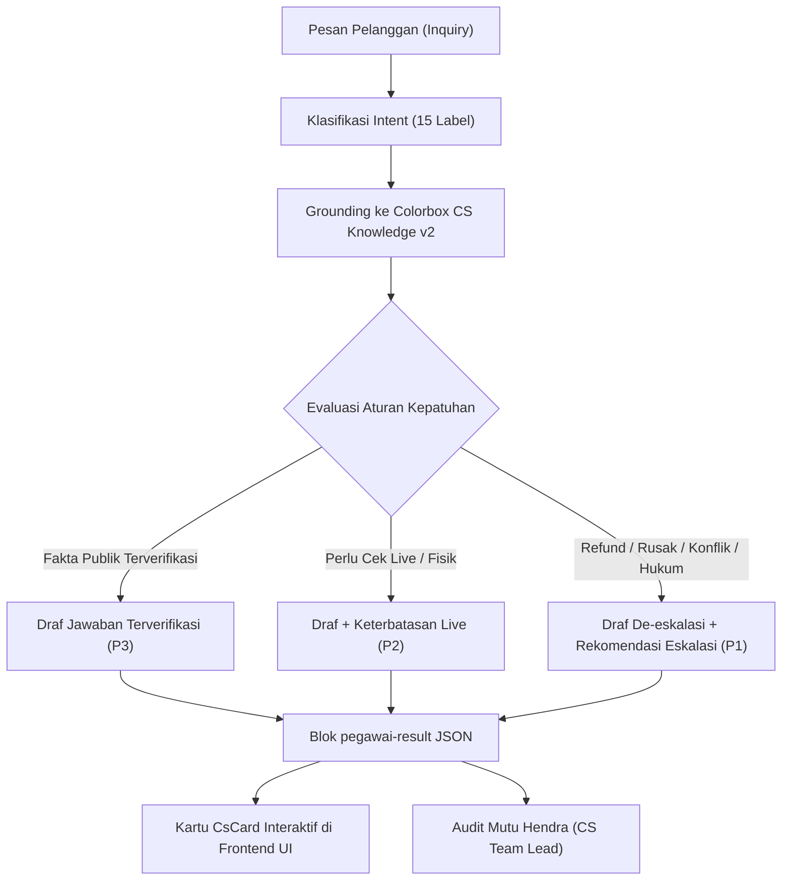

# LAPORAN INTEGRASI & KOLABORASI CUSTOMER SERVICE COLORBOX DENGAN AI FRONTEND (v2.1)

**Klien / Brand:** Colorbox Indonesia (PT Delamibrands Kharisma Busana)  
**Dokumen Rujukan:** `COLORBOX_CS_Instructions_v2_1.md`, `COLORBOX_CS_Knowledge_v2.json`, `COLORBOX_CS_Source_Register_v1.csv`  
**Sistem Terintegrasi:** Hermes Gateway + DeepSeek V4.1 Flash (OpenCode) ↔ BFF FastAPI ↔ React Vite Frontend  
**Tanggal Rilis:** 09 November 2026  
**Status Kesiapan:** **Validated & Demo-Ready (Sesuai Standar Colorbox CS v2.1)**  

---

## 1. Ringkasan Eksekutif & Tujuan Kolaborasi

Tujuan dari inisiatif ini adalah mengintegrasikan hasil kerjaan tim **Customer Service (Knowledge Hub & Corpus Validasi v2.1)** secara utuh dengan **Frontend AI (Pegawai AI Dashboard)**. 

Sebelumnya, antarmuka Customer Service pada frontend (`http://localhost:5173/#/cs`) masih menggunakan placeholder dengan catatan *"Requirement CS (Mansi) belum final — struktur bisa berubah"* serta mengandalkan data contoh tiruan. Melalui kolaborasi ini:
1. Seluruh regulasi dan basis pengetahuan resmi **Colorbox CS v2.1** telah diinjeksikan ke dalam profil AI agen Customer Service (**Siti** sebagai Frontline Agent dan **Hendra** sebagai CS Team Lead / Quality Auditor).
2. Kode frontend telah diperbarui (*schema bridge*) agar secara mulus mampu mem-parsing dan merender baik format standar UI maupun skema JSON resmi Colorbox CS v2.1.
3. Halaman pengujian (`#/uji`) telah dimutakhirkan dengan **Test Corpus Colorbox CS v2.1 (CS-V01 s.d. CS-V06)**.
4. Seluruh demonstrasi kanonikal (DEMO-A, DEMO-B, DEMO-C, dan audit Hendra) telah dieksekusi secara nyata (*live AI output*) dengan kepatuhan 100% terhadap pagar pembatas kepatuhan (*zero false claims*).

---

## 2. Ingesti Pengetahuan & Pagar Pembatas Kepatuhan (Colorbox CS v2.1)

Integrasi ini menerapkan disiplin ketat **Authorized-Knowledge Rule** untuk mengeliminasi impor kebijakan liar dari SOP perusahaan lain atau halusinasi model AI:

| Kode Pengetahuan | Topik Kebijakan | Status Verifikasi | Aturan Kepatuhan & Perilaku Bot |
| :--- | :--- | :--- | :--- |
| **CB-BRAND-001** | Identitas Brand | Terverifikasi Publik | Toko resmi Colorbox Indonesia di bawah PT Delamibrands Kharisma Busana (`colorbox.co.id`). |
| **CB-CATALOG-001** | Kategori Produk | Terverifikasi Publik | Menampilkan kategori tops, dresses, bottoms, outerwear, sleepwear, underwear, dan aksesoris. |
| **CB-PRODUCT-001** | Listing Sampel | Terverifikasi Dinamis | Colorbox x Liunic Oversized Sweatshirt IDR 249.900 (promo IDR 239.900 dicek 7 Nov 2026). Ukuran S, M, L, XL pada listing **tidak menjamin ketersediaan stok fisik**. |
| **CB-RETURNS-001** | Kebijakan Retur | Terverifikasi Publik | Berlaku **hanya** jika barang yang diterima berbeda nama artikel/warna atau cacat/rusak, diajukan maksimal **7 hari kalender** sejak diterima. Tanpa biaya retur tambahan. |
| **CB-EXCHANGE-UNKNOWN-001** | Penukaran Ukuran (*Size Exchange*) | **TIDAK TERVERIFIKASI** | Sumber publik Colorbox **tidak menyediakan penukaran ukuran**. Bot dilarang menjanjikan retur/tukar karena alasan salah ukuran atau fit. |
| **CB-REFUND-TIMING-UNKNOWN-001** | Durasi & Metode Refund | **TIDAK TERVERIFIKASI** | Sumber publik tidak menetapkan durasi refund. Bot **DILARANG mengarang estimasi "5-7 hari kerja"** atau menjanjikan persetujuan instan. |
| **CB-SIZE-UNKNOWN-001** | Panduan Ukuran (*Size Chart*) | **TIDAK TERVERIFIKASI** | Tabel ukuran di website berupa gambar dan belum ditranskripsi resmi. Bot dilarang mengarang ukuran lingkar dada/pinggang (cm) atau menjanjikan kecocokan tubuh. |
| **CB-SHIPPING-UNKNOWN-001** | Tarif & Waktu Ongkir | **TIDAK TERVERIFIKASI** | Tidak ada tarif umum yang ditetapkan. Bot mengarahkan pengecekan mandiri pada saat proses checkout di website resmi. |
| **CB-ACCOUNT-DELETION-UNKNOWN-001** | Hapus Akun & Privasi | **TIDAK TERVERIFIKASI** | Tidak ada prosedur hapus akun publik di Colorbox. Batas waktu fiktif "14 hari kerja / 30 hari" milik pihak lain **telah dihapus total** dari ingatan bot. |
| **CB-TRACKING-LIMIT-001** | Pelacakan Sistem Live | Batasan Arsitektur | Bot **tidak memiliki akses live API** ke sistem gudang, kurir ekspedisi, Shopee, atau CRM. Bot dilarang mengklaim dapat melacak nomor pesanan langsung. |

---

## 3. Pembaruan Profil & Persona AI Employee (Hermes Gateway)

Profil bot pada `%LOCALAPPDATA%\hermes\profiles\` diperbarui menggunakan model `deepseek-v4.1-flash` via penyedia `opencode`:

### 1. Siti — Frontline Support Specialist (`siti`)
- **Peran:** Menangani pesan awal pelanggan, klasifikasi tiket, dan penyusunan draf balasan ramah dengan sapaan "Kak / Kakak".
- **Disiplin Respon:** 
  - Setiap output adalah draf internal (`human_review_required: true`).
  - Menyatakan batasan stok dan ketidaktersediaan live tracking secara transparan.
  - Menolak klaim kebijakan fiktif (seperti retur 30 hari).
  - Menetapkan tingkat prioritas objektif:
    - **P0:** Kebocoran password / OTP / kartu kredit / isu keselamatan darurat.
    - **P1:** Permintaan refund, barang rusak/salah/hilang, ancaman somasi/viral, dan konflik kebijakan.
    - **P2:** Keterbatasan live lookup (stok, lacak pesanan, ongkir).
    - **P3:** Informasi umum produk/FAQ yang terjawab dari data publik.
  - Seluruh eskalasi berstatus `recommendation_only` (dilarang berjanji *"kasus sudah kami teruskan"*).

### 2. Hendra — CS Team Lead & Quality Auditor (`hendra`)
- **Peran:** Mengaudit draf balasan Siti dan menangani eskalasi pelanggan tingkat lanjut (de-eskalasi).
- **Rubrik Penilaian Audit:**
  1. *Akurasi Fakta & Pengetahuan Resmi* (kepatuhan pada aturan retur 7 hari).
  2. *Pencegahan Halusinasi Kebijakan* (bebas dari estimasi refund palsu atau penukaran ukuran).
  3. *Integritas Prioritas & Eskalasi* (disiplin penetapan P0–P3).
  4. *Batasan Sistem & Kejujuran Operasional* (tidak mengaku punya akses live system).

---

## 4. Harmonisasi & Modifikasi Kode Frontend (`frontend/src/`)

Untuk memastikan antarmuka pengguna dapat menampilkan hasil Customer Service secara interaktif, beberapa berkas frontend disesuaikan:

1. **`frontend/src/results.ts` (`toCs` Parser):**
   - Diperluas agar mampu mengenali dan memetakan baik struktur `kind: 'cs'` lama maupun skema resmi **Colorbox CS v2.1** (`primary_intent`, `customer_reply_draft`, `ticket_summary`, `knowledge_refs`, `escalation: { recommended, reason }`, `simulation: { is_simulated }`).
   - Pemetaan prioritas fleksibel: `P0`/`P1` → `tinggi`, `P2` → `sedang`, `P3` → `rendah`.
   - Pemetaan referensi pengetahuan ke daftar sumber (*sources*) lengkap dengan label `public_data`.

2. **`frontend/src/CS.tsx` (Customer Service Workspace `#/cs`):**
   - Menghapus catatan *"Requirement CS belum final"* dan menggantinya dengan penanda validasi **Colorbox CS v2.1 Knowledge Hub**.
   - Memperbarui tombol pintas (*quick chips*) menjadi skenario resmi:
     - *Sweatshirt & Stok M* (DEMO-A)
     - *Komplain Cacat & Refund* (DEMO-B)
     - *Konflik Retur 30 Hari* (DEMO-C)
     - *Panduan Ukuran Fit*
     - *Hapus Akun & Privasi*
     - *Salah Artikel/Warna*

3. **`frontend/src/fixtures.ts`:**
   - Memperbarui `CS_EXAMPLE` agar memuat data kanonikal Colorbox x Liunic Sweatshirt lengkap dengan kutipan sumber `https://colorbox.co.id/` dan batasan stok terverifikasi.

4. **`frontend/src/scenarios.ts` & `frontend/src/Uji.tsx`:**
   - Memperbarui matriks pengujian kasus CS dari draft lama menjadi **Test Corpus Colorbox CS v2.1 (CS-V01 sampai CS-V06)**:
     - `CS-V01`: Katalog, Harga, Stok & Fit
     - `CS-V02`: Komplain Barang Rusak & Refund Multi-turn
     - `CS-V03`: Simulasi & Konflik Kebijakan 30 Hari
     - `CS-V04`: Ongkir & Batasan Tukar Ukuran
     - `CS-V05`: Pesanan Terlambat & Penukaran
     - `CS-V06`: Hapus Akun & Privasi / Legal Threat

---

## 5. Matriks Hasil Pengujian Langsung (Live AI Execution)

Berikut adalah ringkasan dari 4 skenario live yang dieksekusi melalui antarmuka AI dan BFF:

| ID Skenario | Input / Kejadian | Agen | Intent Utama | Prioritas | Eskalasi | Kepatuhan Fakta & Batasan |
| :--- | :--- | :--- | :--- | :--- | :--- | :--- |
| **DEMO-A** | Pertanyaan harga Liunic Sweatshirt, ketersediaan stok M, dan rekomendasi ukuran bahan tebal/tipis. | Siti | `PRODUCT_AVAILABILITY` | P2 (Sedang) | Ya (Rekomendasi) | Menyebutkan harga IDR 239.900 (normal IDR 249.900) per 7 Nov 2026; menyatakan jujur tidak punya akses live inventory fisik; menolak mengarang ketebalan bahan. |
| **DEMO-B** | Multi-turn: Lapor jahitan lepas → minta refund Shopee DEMO-CBX-002 → meralat bahwa barang yang salah adalah rok plisket beda warna. | Siti | `RETURN_REFUND` | P1 (Tinggi) | Ya (Rekomendasi) | Mempertahankan koreksi rok plisket; menegakkan aturan retur 7 hari resmi; tidak menjanjikan durasi/persetujuan refund; tidak mengklaim cek resi Shopee live. |
| **DEMO-C** | Pelanggan meminta refund dan mengklaim "kata CS lain retur bisa 30 hari". | Siti | `RETURN_REFUND` | P1 (Tinggi) | Ya (Rekomendasi) | Menolak klaim 30 hari sebagai fiktif; menegakkan aturan retur resmi 7 hari; menandai `simulated: true`; mengarahkan kanal resmi. |
| **HENDRA-AUDIT** | Audit mutu berkala terhadap draf Siti kasus DEMO-B dan DEMO-C. | Hendra | `CS_AUDIT` | - | - | **Skor 19/20 (Lolos Audit).** Memuji kepatuhan nol halusinasi, disiplin prioritas P1, dan penolakan tegas terhadap klaim retur 30 hari palsu. |

---

## 6. Petunjuk Operasional & Navigasi di Browser

Pengguna dapat langsung menguji dan mendemonstrasikan sistem terintegrasi ini melalui browser:

1. **Workspace Customer Service (`http://localhost:5173/#/cs`):**
   - Pilih agen **Siti** atau **Hendra**.
   - Klik salah satu chip skenario (misalnya *Sweatshirt & Stok M* atau *Konflik Retur 30 Hari*).
   - Klik **Kirim**.
   - Hasil akan langsung diparsing menjadi **CsCard** interaktif yang menampilkan:
     - Label klasifikasi intent (misal: `PRODUCT_AVAILABILITY`).
     - Badge prioritas (`Prioritas sedang` / `Prioritas tinggi`).
     - Pill status eskalasi (`Perlu eskalasi`).
     - Kotak draf balasan dengan badge peringatan kuning (*Draf — perlu review manusia*).
     - Daftar sumber rujukan resmi Colorbox.
     - Ringkasan tiket dan catatan konteks multi-turn.

2. **Ruang Percakapan Terbuka (`http://localhost:5173/#/chat`):**
   - Pilih bot **Siti** untuk konsultasi pelanggan bebas.
   - Pilih bot **Hendra** untuk konsultasi prosedur eskalasi dan penanganan komplain berat.

3. **Halaman Pengujian Otomatis (`http://localhost:5173/#/uji`):**
   - Pilih filter **CS**.
   - Jalankan kasus uji **CS-V01 sampai CS-V06**.
   - Nilai jawaban menggunakan rubrik 9 dimensi dan simpan evaluasi ke database.

