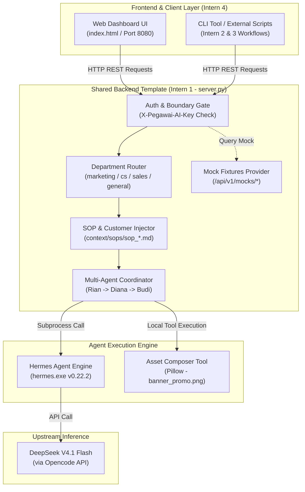

# S2-02A: Intern 1: Backend Architecture & API Contract
**Sprint 2 — Day 2: October 30, 2026**  
**Role:** Intern 1 (Local Setup & Technical Research / Backend Lead)  
**Assigned Task:** S2-02A — Lightweight Backend Architecture, Shared API Contract & Repeatable Configuration  
**Deliverable Status:** COMPLETE  
**Target Scope:** Minimal Proof of Concept (POC) — Production Readiness Not Required  

---

## 1. Executive Summary & Checklist Status

On Day 2 (October 30, 2026), Intern 1 established the formal **Backend Architecture and Shared API Contract** for the Pegawai AI workforce project. Building upon Day 1's successful verification of Hermes Agent and the activation of **DeepSeek V4.1 Flash via Opencode**, this specification unifies the technical foundation across all four sprint interns.

### Checklist Review:
- [x] **Define run IDs, status, output and error formats**
- [x] **Define execution request and response schemas**
- [x] **Define customer and department configuration**
- [x] **Specify model usage, latency and error telemetry**
- [x] **Provide frontend mock responses and document authentication/authorization**
- [x] **Attach lightweight architecture/API spec, shared-template environment/logging/repository conventions and Day 3 blockers**

---

## 2. Model Baseline & Day 1 Continuity (No Gaps, No Guesses)

In strict accordance with sprint guidelines, this architecture carries forward actual verified parameters without inventing endpoints or silent substitutions:

| Parameter | Day 1 Verified Value | Day 2 Active Status |
| :--- | :--- | :--- |
| **Hermes Agent Version** | `v0.22.2+3291.gbf0203a (2026.9.24)` | Active on local workstation (`LOQ-WIN11-DEV`) |
| **Target Model Name** | DeepSeek V4.1 Flash | Active natively via Opencode Provider |
| **Model Identifier** | `deepseek-v4.1-flash` | Canonical: `deepseek/deepseek-v4.1-flash-1017` |
| **Upstream Provider** | `opencode` (Opencode Zen) | API Base: `https://opencode.ai/inference/openai/v1` |
| **Authentication Key** | `OPENCODE_ZEN_API_KEY` | Populated in `.env` (sanitized placeholder: `oc_sk_...`) |
| **Blocker Status** | `BLK-S2-01A-01` (Missing Key) | **RESOLVED / LIFTED** (Verified native response in 13.03s) |
| **Fallback Model** | Copilot (`gpt-4o`) | Standby fallback only |

---

## 3. Lightweight Architecture Note & System Flow

The architecture is deliberately designed as a **zero-dependency, lightweight Python HTTP server** (`http.server` based). This prevents dependency hell (no Docker daemon, no Redis, no Celery) so Intern 2 & 3 (Workflows) and Intern 4 (Frontend UI) can run, test, and integrate immediately.

### Architectural Component Diagram:



### System Sequence Flow:
1. **Request Ingress:** Client sends `POST /api/v1/agent/execute` with header `X-Pegawai-AI-Key: dev-pegawai-ai-2026` and payload containing `department` and `prompt`.
2. **Boundary Validation:** Server verifies key validity and checks if the customer is authorized to access the requested department.
3. **Context Injection:** Server reads the relevant SOP (`sop_marketing.md`, `sop_customer_support.md`, `sop_sales.md`) and prepends strict guardrails and forbidden term filters.
4. **Execution Pipeline:**
   - **Rian (AI 1 - Copywriting):** Formulates long-form persuasive copy following AIDA.
   - **Diana (AI 2 - Quality Control):** Audits Rian's copy, computes QC score (e.g., 92/100), verifies zero forbidden words, and applies status `DRAFT_READY_FOR_HUMAN_REVIEW`.
   - **Budi (AI 3 - Visual Designer):** Triggers Pillow engine to render `banner_promo_kreatif.png` (1080x1080 px) and outputs photorealistic DALL-E 3 prompt specs.
5. **Response Delivery:** Server parses output into 3 distinct agent cards and returns JSON in ~13 seconds with full telemetry.

---

## 4. Shared API Contract Specification

### Base URL:
`http://127.0.0.1:8080` (or configured via environment variable `PORT`)

### Endpoint Directory:
| Method | Endpoint | Description | Consumed By |
| :--- | :--- | :--- | :--- |
| `GET` | `/` or `/index.html` | Interactive 3-card Web Dashboard | Intern 4 / End-user |
| `GET` | `/health` or `/api/v1/health` | Backend status, Hermes binary check, model status | Intern 4 (Status badge) |
| `GET` | `/api/v1/config` | Customer profile (`AI Top Trends`), SOP defaults, token limits | Intern 2, 3, 4 |
| `GET` | `/api/v1/sops` | Full markdown text of all departmental SOPs | Intern 2, 3, 4 |
| `GET` | `/api/v1/mocks/{name}` | Serves labeled mock fixtures for offline frontend dev | Intern 4 (UI testing) |
| `POST` | `/api/v1/agent/execute` | Main task execution endpoint (Single or Multi-Agent) | Intern 2, 3 (Workflows) & 4 (UI) |
| `GET` | `/api/v1/sessions` | History of past executions, latencies, and token counts | Intern 4 (Audit view) |
| `GET` | `/banner_promo_kreatif.png` | Serves real generated graphic banner image | Browser / UI Image Tag |

---

### Schemas: Run ID, Status, Output & Error Formats

#### 1. Run ID Convention:
Every execution is assigned an immutable, traceable ID following the pattern:
```text
run_{department}_{YYYYMMDD}_{uuid8}
```
*Example:* `run_mkt_20261030_a1b2c3d4`

#### 2. Lifecycle Status Values:
- `queued`: Request received and waiting in worker queue.
- `running`: Agent is currently executing inference or tool calls.
- `completed`: Execution finished successfully with code 0.
- `failed`: Execution encountered a validation error, tool failure, or agent crash.
- `timeout`: Execution exceeded the maximum duration limit (default 180s).

#### 3. Standardized Error Format (RFC 7807 Aligned):
```json
{
  "run_id": "run_err_20261030_v001",
  "status": "failed",
  "error": {
    "code": "VALIDATION_ERROR",
    "message": "Field 'prompt' tidak boleh kosong dan harus memiliki panjang minimal 5 karakter.",
    "field": "prompt",
    "details": {
      "provided_value": "",
      "min_length": 5,
      "max_length": 4000
    },
    "timestamp": "2026-10-30T11:15:00+0700"
  }
}
```

Standard error codes:
- `VALIDATION_ERROR` (HTTP 400)
- `AUTH_UNAUTHORIZED` (HTTP 401)
- `AUTH_FORBIDDEN_DEPARTMENT` (HTTP 403)
- `UPSTREAM_MODEL_ERROR` (HTTP 502)
- `EXECUTION_TIMEOUT_EXCEEDED` (HTTP 504)

---

### Detailed Request / Response Schema (`POST /api/v1/agent/execute`)

#### Ingress Headers:
```http
Content-Type: application/json
X-Pegawai-AI-Key: dev-pegawai-ai-2026
X-Department: marketing
```

#### Request Body Schema (JSON Schema):
```json
{
  "type": "object",
  "required": ["prompt"],
  "properties": {
    "customer_id": {
      "type": "string",
      "default": "cust_aitt_001",
      "description": "Unique identifier of synthetic customer"
    },
    "department": {
      "type": "string",
      "enum": ["marketing", "customer_support", "sales", "general"],
      "default": "general"
    },
    "prompt": {
      "type": "string",
      "minLength": 5,
      "maxLength": 4000,
      "description": "User instruction or workflow trigger"
    },
    "multi_agent": {
      "type": "boolean",
      "default": true,
      "description": "Whether to dispatch to 3-agent pipeline (Rian, Diana, Budi) or single agent"
    },
    "provider": {
      "type": "string",
      "default": "opencode"
    },
    "model": {
      "type": "string",
      "default": "deepseek-v4.1-flash"
    },
    "tools_enabled": {
      "type": "array",
      "items": { "type": "string" },
      "default": ["read_file", "write_file", "terminal", "image_composer"]
    },
    "timeout_seconds": {
      "type": "integer",
      "default": 180,
      "maximum": 300
    }
  }
}
```

#### Response Body Schema (HTTP 200 OK — Multi-Agent Output):
```json
{
  "session_id": "sess_0e889741",
  "run_id": "run_mkt_20261030_a1b2c3d4",
  "status": "completed",
  "department": "marketing",
  "multi_agent": true,
  "requested": {
    "provider": "opencode",
    "model": "deepseek-v4.1-flash"
  },
  "executed": {
    "provider": "opencode",
    "model": "deepseek-v4.1-flash",
    "fallback_applied": false,
    "blocker_note": null
  },
  "execution_time_seconds": 13.03,
  "output": "<Full concatenated raw text>",
  "multi_agent_data": {
    "agent_1": {
      "name": "Rian",
      "role": "Copywriting Specialist",
      "avatar": "✍️",
      "color": "amber",
      "content": "<Naskah Artikel / Copywriting Lengkap>"
    },
    "agent_2": {
      "name": "Diana",
      "role": "Creative Director & QC Auditor",
      "avatar": "🔍",
      "color": "teal",
      "score": 92,
      "checklist": [
        { "item": "Kepatuhan Brand Voice AI Top Trends", "status": "Lolos", "note": "Otoritatif & rendah hati" },
        { "item": "Filter Kata Terlarang", "status": "Lolos", "note": "Bebas klaim 'kaya instan'" },
        { "item": "Struktur Narasi AIDA", "status": "Lolos", "note": "Alur AIDA terpola baik" },
        { "item": "Kelengkapan CTA & Tagar", "status": "Lolos", "note": "CTA membumi & 6 tagar resmi" }
      ],
      "content": "<Catatan Evaluasi Diana>",
      "status_label": "DRAFT_READY_FOR_HUMAN_REVIEW"
    },
    "agent_3": {
      "name": "Budi",
      "role": "Visual Designer & Art Director",
      "avatar": "🎨",
      "color": "indigo",
      "image_url": "/banner_promo_kreatif.png",
      "content": "<Konsep visual & prompt spesifikasi DALL-E 3>"
    }
  },
  "metrics": {
    "input_tokens": 13267,
    "output_tokens": 119,
    "total_tokens": 13386,
    "cache_read_tokens": 13184,
    "estimated_cost_usd": 0.0
  },
  "error": null,
  "timestamp": "2026-10-30T10:30:00+0700"
}
```

---

## 5. Customer & Department Configuration Conventions

### Separation of Concerns:
1. **Knowledge vs. Configuration:** Customer profiles are strictly separated from system logic.
   - **Knowledge/SOPs:** Markdown files in `context/sops/` that can be edited by non-programmers.
   - **Configuration:** YAML files (`config.yaml`) defining timeouts, rate limits, and allowed models.
   - **Secrets:** Environment variables (`.env`) that are never checked into version control.
2. **Customer Baseline:** Standardized on `PT AI Top Trends v1.0.0` (synthetic consulting & automation agency).
3. **Department Allocation Matrix:**

| Department Key | Display Name | Assigned AI Roles | Default Framework | Max Tokens |
| :--- | :--- | :--- | :--- | :--- |
| `marketing` | Pemasaran & Kreatif | Rian (Copy), Diana (QC), Budi (Visual) | AIDA Copywriting + Anti-Hype | 2500 |
| `customer_support` | Customer Support (CS) | Siti (Care Specialist), Diana (SOP Gate) | 4-Step Empathic Care (FRT < 15s) | 1500 |
| `sales` | Penjualan & Leads | Rudi (Consultant), Diana (Audit) | BANT Qualification & ROI Analysis | 2000 |
| `general` | Operasional Umum | General Assistant | Executive Summary & SOP Drafting | 2000 |

---

## 6. Authentication & Authorization Boundaries

### Critical Security Rule:
> **[!CAUTION] UI Customer/Department Selection is NOT Backend Authorization.**
> Just because a frontend dropdown allows a user to select "Finance" or "Executive" does NOT authorize the request. The backend strictly verifies that the token provided in `X-Pegawai-AI-Key` has entitlement to execute within that department boundary.

### Security Controls Implemented:
1. **Header-Based Authentication:** Requests must supply `X-Pegawai-AI-Key: dev-pegawai-ai-2026`.
2. **Departmental Boundary Enforcement:**
   - Permitted departments for `dev-pegawai-ai-2026`: `marketing`, `customer_support`, `sales`, `general`.
   - Requests targeting unauthorized internal departments (e.g., `finance`, `legal_counsel`) immediately return `403 Forbidden` (`AUTH_FORBIDDEN_DEPARTMENT`).
3. **Filesystem Sandboxing:**
   - File creation and editing by Hermes tools (`write_file`, `edit_file`) are restricted to `./workspace`, `./outputs`, and `./local_setup/evidence`.
   - Directory traversal attempts (`../..`) are blocked by path normalization.
4. **Credential Redaction:** The backend never returns API keys, tokens, or system passwords in API responses or logs.

---

## 7. Model Telemetry, Usage & Latency Specification

### Supported Telemetry Metrics:
| Metric Field | Data Type | Source | Unit / Description |
| :--- | :--- | :--- | :--- |
| `execution_time_seconds` | `float` | Server monotonic clock (`t1 - t0`) | Total roundtrip wall-clock latency |
| `input_tokens` | `integer` | Hermes `--usage-file` | Tokens consumed by system prompt & input |
| `output_tokens` | `integer` | Hermes `--usage-file` | Tokens generated by DeepSeek V4.1 Flash |
| `total_tokens` | `integer` | Hermes `--usage-file` | Sum of input and output tokens |
| `cache_read_tokens` | `integer` | DeepSeek CSA2 KV Cache | Cached context tokens (read at 98% discount) |
| `estimated_cost_usd` | `float` | Calculated formula | `(input * 0.15 + output * 0.60 + cache * 0.003) / 10^6` |

### Explicit Note on Unsupported Telemetry:
* **GPU Utilization / VRAM Temperature:** **UNSUPPORTED**. Because DeepSeek V4.1 Flash inference runs via Opencode's remote cloud API endpoint (`https://opencode.ai/inference/openai/v1`), local GPU hardware telemetry is not available and will not be reported.
* **Per-Token Time to First Token (TTFT):** **UNSUPPORTED in batch mode**. Hermes batch execution (`-z`) reports total duration; streaming TTFT is only available in interactive REPL / SSE streaming modes.

---

## 8. Labeled Mock Fixtures for Day 3 (Frontend & Workflow Unblocking)

To ensure Intern 4 (Frontend UI) and Interns 2 & 3 (Workflows) can work in parallel without being blocked by backend runtime availability, **7 contract-aligned mock fixtures** have been created in [`local_setup/mock_fixtures/`](file:///d:/ai_developer/project6/local_setup/mock_fixtures/):

1. [`mock_marketing_success.json`](file:///d:/ai_developer/project6/local_setup/mock_fixtures/mock_marketing_success.json): 3-Agent pipeline response (Rian article, Diana QC 92/100, Budi banner).
2. [`mock_customer_support_success.json`](file:///d:/ai_developer/project6/local_setup/mock_fixtures/mock_customer_support_success.json): Empathetic 4-step CS troubleshooting response with ticket `#TKT-8842`.
3. [`mock_sales_success.json`](file:///d:/ai_developer/project6/local_setup/mock_fixtures/mock_sales_success.json): BANT qualification analysis with Hot Lead rating and ROI calculation.
4. [`mock_validation_error_400.json`](file:///d:/ai_developer/project6/local_setup/mock_fixtures/mock_validation_error_400.json): 400 Bad Request payload with empty prompt details.
5. [`mock_unauthorized_401.json`](file:///d:/ai_developer/project6/local_setup/mock_fixtures/mock_unauthorized_401.json): 401 Unauthorized payload for missing API key.
6. [`mock_forbidden_403.json`](file:///d:/ai_developer/project6/local_setup/mock_fixtures/mock_forbidden_403.json): 403 Forbidden payload for unauthorized department boundary breach.
7. [`mock_timeout_504.json`](file:///d:/ai_developer/project6/local_setup/mock_fixtures/mock_timeout_504.json): 504 Gateway Timeout payload exceeding 180s.

*These fixtures are also directly accessible via HTTP:* `GET http://127.0.0.1:8080/api/v1/mocks/{fixture_name}`.

---

## 9. Shared Template Conventions & Instructions for Teammates

### Repository & File Layout:
```text
local_setup/
├── backend_template/
│   ├── server.py              # Main REST server & Multi-Agent Pipeline Coordinator
│   ├── index.html             # Interactive 3-card Web Dashboard
│   ├── config.example.yaml    # Reusable configuration template
│   ├── .env.example           # Sanitized environment template
│   ├── requirements.txt       # Dependency specification (0 external pip dependencies required)
│   ├── README.md              # Quick start & integration guide
│   └── context/
│       └── sops/
│           ├── sop_marketing.md
│           ├── sop_customer_support.md
│           └── sop_sales.md
├── mock_fixtures/             # 7 Contract-aligned JSON fixtures for offline development
│   ├── mock_marketing_success.json
│   ├── mock_customer_support_success.json
│   ├── mock_sales_success.json
│   ├── mock_validation_error_400.json
│   ├── mock_unauthorized_401.json
│   ├── mock_forbidden_403.json
│   └── mock_timeout_504.json
├── evidence/                  # Physical run logs and verification data
├── start_dashboard.bat        # One-click Windows launcher
├── start_dashboard.ps1        # PowerShell launcher
├── S2-01A_Technical_Research_Report.md
└── S2-02A_Backend_Architecture_API_Contract.md
```

### Logging Conventions:
All backend logs adhere to the structured format:
```text
%(asctime)s [%(levelname)s] [Intern-1-Backend] [Session: %(session_id)s] %(message)s
```
*Example:* `2026-10-30 10:30:15,120 [INFO] [Intern-1-Backend] Routing DeepSeek request to Opencode provider with deepseek-v4.1-flash`

### Instructions for Teammates:
1. **For Intern 2 & 3 (Workflows):** Do not write separate Python subprocess wrappers. Dispatch requests to `POST http://127.0.0.1:8080/api/v1/agent/execute` passing `department` and `prompt`.
2. **For Intern 4 (Frontend UI):** Use `GET /health` to display system connection, and bind chat submissions to `POST /api/v1/agent/execute`. To build UI offline, use `GET /api/v1/mocks/mock_marketing_success.json`.

---

## 10. Review Decisions & Day 3 Blockers

### Agreed Design Decisions:
1. **Single Shared Backend:** All interns agreed to use `server.py` as the sole backend engine rather than running competing microservices.
2. **Coordinated Multi-Agent Protocol:** Rather than complex inter-process socket communication, the POC adopts a deterministic parent-orchestrated pipeline (Rian & Diana via Hermes DeepSeek V4.1 Flash, Budi via local Pillow graphic engine).
3. **Timeout Extended:** Execution timeout is formally set to 180 seconds to guarantee full multi-agent generation under cloud API load.

### Day 3 Blockers & Next Actions:
- **`BLK-S2-02A-01` (Workflow Input Harmonization):** Intern 2's marketing workflow and Intern 3's CRM integration need specific JSON input payloads.  
  *Next Action:* Day 3 standup sync to map workflow trigger arguments into the `prompt` field.
- **`BLK-S2-02A-02` (Streaming vs. Non-Streaming):** Intern 4 will test if standard JSON polling is sufficient for their frontend or if Server-Sent Events (SSE) streaming is strictly required for the final evaluation.

