# S3-01A: Review Existing Hermes Foundation & Colorbox AI Employees Architecture

**Sprint:** Sprint 3 — Day 1 (November 5, 2026)  
**Task Title:** Review the Existing Hermes Foundation & Handoff  
**Assignee:** Intern 1 (Backend & Platform Lead)  
**Linked Activity:** [ClickUp Task z8xxqwefqm](https://app.clickup.com/t/z8xxqwefqm) (Architecture, Schemas, & API Contract v1 Design)  
**Package Budget:** 6 Focused Hours (Assessment, Capability Classification, Schema Mapping & Handoff)  
**Status:** COMPLETE (Foundation Audited, Matrix Classified, Schemas Defined, Handoff Prepared)  

---

## 1. Executive Summary & Objective

Tujuan utama dari task ini adalah melakukan **penilaian penggunaan kembali (Reuse Assessment)** terhadap fondasi teknis yang telah berhasil dibangun pada Sprint 2 (Hermes Agent CLI `v0.22.2`, DeepSeek V4.1 Flash via Opencode Zen / direct provider, shared backend template, dan multi-agent delimiters) untuk diadaptasikan ke **dua peran karyawan AI bisnis baru**:
1. **Colorbox Marketing AI Employee:** Alur kerja terstruktur (*Brief $\rightarrow$ Planning $\rightarrow$ Generation $\rightarrow$ Brand Review $\rightarrow$ Revision*).
2. **Colorbox Customer Service (CS) AI Employee:** Alur kerja penanganan pertanyaan dan keluhan (*Inquiry $\rightarrow$ Classification $\rightarrow$ Retrieval $\rightarrow$ Draft $\rightarrow$ Escalation*).

### Batasan Kritis (Operational & Security Boundaries):
* **No Setup Repetition:** Tidak ada instalasi ulang binary Hermes, konfigurasi virtual environment baru, atau perombakan infrastruktur dasar.
* **Public Colorbox Data Only:** Menggunakan informasi publik Colorbox (brand fashion ritel remaja/wanita muda Indonesia). Membedakan secara tegas antara **Fakta Terverifikasi** (kebijakan retur 7 hari, toko offline/online), **Asumsi Bisnis**, dan **Data Dummy/Sintetis** (nomor order dummy `#CBX-2026-9812`).
* **Zero Live Integration Risk:** Tidak ada koneksi live ke Shopee Mall API, Instagram Graph API, sistem ERP internal, inventaris SAP, atau payment gateway. Semua disimulasikan secara aman tanpa transaksi finansial nyata.
* **Human-in-the-Loop Required:** Naskah pemasaran dan draf tanggapan CS berstatus *DRAFT* yang memerlukan review manusia sebelum publikasi/pengiriman.

---

## 2. Sprint 2 Component Reuse Inventory

Evaluasi komponen yang dibangun pada Sprint 2 (S2-01A s/d S2-04A) dan kelayakannya untuk digunakan kembali pada Colorbox:

| Komponen Sprint 2 | Lokasi File Eksisting | Status Verifikasi | Keputusan Reuse | Catatan Adaptasi untuk Colorbox |
| :--- | :--- | :--- | :--- | :--- |
| **Hermes Execution Core** | `%LOCALAPPDATA%\hermes\bin\hermes.exe` | **VERIFIED WORKING** (S2-04A: 91.02s roundtrip) | **REUSE 100%** | Mempertahankan pemanggilan `-z` dengan `--usage-file`. Timeout dinaikkan ke 180 detik. |
| **Model & Provider Configuration** | `deepseek-v4.1-flash` via `opencode` / `deepseek` | **VERIFIED WORKING** (Zero substitution) | **REUSE 100%** | Tetap menggunakan DeepSeek V4.1 Flash tanpa substitusi model silang. |
| **Shared Backend Server** | `local_setup/backend_template/server.py` | **VERIFIED WORKING** (HTTP 8080) | **REUSE 90%** | Tambahkan endpoint rute `/api/v1/colorbox/*` berdampingan dengan endpoint existing. |
| **Delimited Multi-Agent Parser** | Regex parser `===BAGIAN_1===` | **VERIFIED WORKING** | **REUSE & EXTEND** | Perluas penanda blok untuk mengakomodasi alur 5-tahap Marketing dan 5-tahap CS. |
| **SOP & Context Ingestion** | `local_setup/backend_template/context/sops/` | **VERIFIED WORKING** (Markdown file loader) | **REUSE & EXTEND** | Tambahkan dokumen `colorbox_brand_guidelines.md` dan `colorbox_cs_sop.md`. |
| **Health Check & Diagnostic** | `/health` & `/api/v1/health` | **VERIFIED WORKING** | **REUSE 100%** | Mendeteksi ketersediaan binary, status provider, dan latency secara realtime. |
| **Banner Generator (Pillow)** | `generate_banner_image()` | **VERIFIED WORKING** (Local PNG asset) | **REUSE & OPTIMIZE** | Ubah menjadi opsional (hanya di-trigger jika brief marketing membutuhkan aset visual grafis). |

---

## 3. Approved Platform Capability Matrix (Hermes Foundation Review)

Sesuai arahan revisi platform tanggal 5 November, berikut adalah klasifikasi kapabilitas Hermes Agent ke dalam 4 kategori status: **Working**, **Mocked**, **Unsupported**, atau **Blocked**:

| Kapabilitas Platform | Status Klasifikasi | Bukti Eksisting / Realita Teknis | Keputusan Desain & Tindakan Lanjutan |
| :--- | :--- | :--- | :--- |
| **1. Agent Management & Chat** | **WORKING (Single-Turn)**<br>**MOCKED (Multi-Turn)** | Eksekusi single-prompt via CLI flag `-z` berjalan 100% stabil. Namun, Hermes CLI bersifat *stateless* (tidak menyimpan history antar-request). | **Buat Adapter Backend Ringan:** Backend mengelola array sesi percakapan (`session_id`) dan menginjeksi 3 riwayat chat terakhir ke dalam prompt konteks. |
| **2. Tools / Plugins Registry & Assignment** | **MOCKED / PARTIAL** | Pembuatan banner gambar dijalankan oleh script Python lokal (`PIL`), bukan melalui mekanisme pemanggilan tool dinamis (*Function Calling*) Hermes. | Pertahankan eksekusi tool lokal yang dikontrol backend. Hindari ketergantungan pada registri plugin Hermes yang belum terverifikasi. |
| **3. Integration Connection States** | **WORKING** | Endpoint `/health` secara akurat memeriksa binary path, verifikasi API Key (`OPENCODE_ZEN_API_KEY`), dan model target. | Tambahkan health status khusus untuk modul Colorbox Knowledge Index. |
| **4. Computer Use (OS / Desktop GUI)** | **UNSUPPORTED** | Hermes CLI v0.22.2 di Windows saat ini beroperasi berbasis terminal teks; tidak memiliki modul Computer Use untuk klik desktop/GUI. | **Tolak / Out of Scope.** Alur kerja Colorbox adalah pembuatan naskah dan draf respons berbasis teks & grafis statis, sehingga Computer Use tidak relevan. |
| **5. Scheduler Job Management** | **BLOCKED (Natively)** | Hermes CLI tidak memiliki daemon penjadwalan (*cron scheduler*) internal untuk eksekusi berkala. | **Gunakan Backend Scheduler:** Otomasi penjadwalan dikelola di level backend (Python `threading.Timer` atau `APScheduler`), bukan di dalam Hermes CLI. |
| **6. Activity & Execution Status** | **WORKING** | Penangkapan metrik token input/output via `--usage-file usage.json`, status proses exit code, dan durasi latensi telah terverifikasi. | Terapkan pembacaan token yang sama untuk semua permintaan Colorbox. |

---

## 4. Pemetaan Alur Bisnis 2 Karyawan AI Colorbox

```mermaid
flowchart TD
    subgraph "Colorbox Marketing Employee"
        M1["Brief Masuk (Tema / Koleksi)"] --> M2["1. Planning (Ide & Kalender)"]
        M2 --> M3["2. Generation (Copy AIDA & Alternatif)"]
        M3 --> M4["3. Brand Review (Tone Cheerful & Zero Claims)"]
        M4 --> M5["4. Revision (Draf Siap Review)"]
    end

    subgraph "Colorbox Customer Service Employee"
        C1["Customer Inquiry / Keluhan"] --> C2["1. Intent Classification (Delivery/Return/Size)"]
        C2 --> C3["2. Knowledge Retrieval (SOP Retur 7 Hari)"]
        C3 --> C4["3. Draft Response (Empatik & Solutif)"]
        C4 --> C5["4. Escalation & Ticket Summary (Priority: HIGH/MED)"]
    end
```



### A. Colorbox Marketing AI Employee
* **Identitas Brand:** Colorbox adalah merek fashion retail remaja dan wanita muda di Indonesia yang mengusung gaya *trendy, casual, fun, expressive, dan accessible*.
* **Tahapan Alur Kerja:**
  1. **Brief Masuk:** Tema kampanye (misal: *"Summer Pastel Collection 2026"* atau *"Promo Payday Diskon 30%"*).
  2. **Planning:** Menghasilkan 3 ide pilar konten dan rekomendasi jadwal tayang (*Content Calendar*).
  3. **Generation:** Menyusun 2 variasi naskah copywriting (Instagram Carousel / TikTok script) menggunakan formula AIDA dengan gaya bahasa *friendly, energetic, non-formal (kasual sopan)*.
  4. **Brand & Audience Review:** Audit internal memeriksa apakah ada klaim berlebihan (*zero misleading claims*), kesesuaian palet warna pastel/terang, dan kesesuaian target Gen-Z.
  5. **Revision:** Catatan perbaikan naskah sebelum diajukan ke Marketing Lead.

### B. Colorbox Customer Service (CS) AI Employee
* **Kebijakan Publik Resmi (Verified Knowledge):**
  * Penukaran produk (*Exchange*) maksimal **7 hari** kalender sejak barang diterima.
  * Syarat wajib: Tag harga masih terpasang, struk pembelian/faktur online asli, produk belum dicuci/dipakai, dan bukan kategori *underwear/aksesoris tertentu*.
  * Kendala pengiriman: Estimasi reguler 2–5 hari kerja (Jabodetabek) dan 3–7 hari kerja (Luar Pulau Jawa).
* **Tahapan Alur Kerja:**
  1. **Inquiry:** Menerima pertanyaan/keluhan pelanggan (misal: *"Ukuran celana kebesaran, mau tukar size M ke S gimana caranya?"*).
  2. **Classification:** Klasifikasi niat pelanggan (`SIZE_EXCHANGE`, `DELIVERY_DELAY`, `DEFECTIVE_ITEM`, `PROMO_INQUIRY`, `REFUND_REQUEST`).
  3. **Knowledge Retrieval:** Mengambil pasal SOP yang relevan dari repositori SOP lokal Colorbox.
  4. **Response Draft:** Menyusun draf jawaban ramah, meminta nomor pesanan dummy `#CBX-...`, dan menjelaskan langkah retur dengan jelas.
  5. **Escalation & Ticket Summary:** Menentukan skor urgensi, prioritas (`LOW`, `MEDIUM`, `HIGH`, `CRITICAL`), dan menentukan apakah butuh eskalasi ke supervisor (*Human CS Takeover*).

---

## 5. Proposed API Contract v1 (Handoff to Linked Activity z8xxqwefqm)

Berikut adalah rancangan spesifikasi kontrak API v1 yang diselaraskan dengan kebutuhan tim Frontend:

### Endpoint Overview

| Method | Endpoint | Fungsi | Payload Utama |
| :--- | :--- | :--- | :--- |
| `POST` | `/api/v1/colorbox/marketing/generate` | Menjalankan pipeline lengkap Marketing Colorbox | `campaign_brief`, `content_type`, `target_channel` |
| `POST` | `/api/v1/colorbox/cs/chat` | Memproses percakapan interaktif CS multi-turn | `session_id`, `customer_message`, `channel` |
| `POST` | `/api/v1/colorbox/cs/reset-session` | Mereset riwayat percakapan sesi CS | `session_id` |
| `GET` | `/api/v1/colorbox/knowledge/lookup` | Mengambil referensi pasal SOP berbasis keyword | `query`, `category` |

---

### Request & Response Examples

#### 1. Marketing Generation Contract
**Request (`POST /api/v1/colorbox/marketing/generate`):**
```json
{
  "client_id": "colorbox_retail_id",
  "campaign_brief": "Promo Koleksi Casual Linen untuk Remaja Menghadapi Liburan Semester",
  "content_type": "instagram_carousel",
  "target_channel": "instagram",
  "include_visual_concept": true
}
```

**Response (`200 OK`):**
```json
{
  "status": "success",
  "workflow": "colorbox_marketing_v1",
  "execution_duration_sec": 42.15,
  "usage": {
    "prompt_tokens": 820,
    "completion_tokens": 1140,
    "total_tokens": 1960
  },
  "data": {
    "planning": {
      "campaign_theme": "Casual Linen Summer Vibes",
      "content_pillar": "Product Styling & Tips",
      "recommended_publish_time": "Kamis, 19:00 WIB"
    },
    "generation": {
      "primary_copy": "Libur semester tinggal hitungan hari, outfit kamu udah siap belum? ✨ Kenalin Casual Linen Series dari Colorbox! Adem, jatuh di badan, dan pastinya bikin OOTD kamu auto-aesthetic tanpa ribet. Geser ke kanan buat intip 3 style favorit minggu ini 👉",
      "call_to_action": "Beli di Colorbox terdekat atau klik link di bio sekarang!",
      "hashtags": ["#ColorboxBabes", "#OOTDColorbox", "#CasualLinenStyle", "#FashionRemaja"],
      "copy_alternative": "Anti-gerah club! Saatnya upgrade gaya liburan kamu dengan koleksi Linen Colorbox. Stylish, nyaman, dan ramah di kantong!"
    },
    "brand_review": {
      "compliance_score": 96,
      "tone_audit": "PASSED (Cheerful, approachable, Gen-Z friendly)",
      "claim_verification": "PASSED (Zero false promises, harga & bahan realistis)",
      "recommendations": "Pertahankan penggunaan emoji yang ceria namun tidak berlebihan."
    },
    "visual_concept": {
      "layout_mood": "Warm daylight, natural pastel tone (sage green & soft beige), flatlay & model on-street",
      "color_palette": ["#B2C9AB", "#E8D8C8", "#FFFFFF"],
      "image_prompt_en": "Professional clean lookbook fashion photography, young Asian woman smiling wearing light sage green linen shirt, soft natural lighting, high fashion minimal composition, 4k"
    },
    "status": "DRAFT_AWAITING_HUMAN_APPROVAL"
  }
}
```

---

#### 2. Customer Service Multi-Turn Contract
**Request (`POST /api/v1/colorbox/cs/chat`):**
```json
{
  "session_id": "sess_cbx_cust_88219",
  "customer_name": "Nadia",
  "customer_message": "Kak, baju yang kemarin saya beli di Colorbox PIM kekecilan, apakah bisa ditukar ukurannya?",
  "channel": "whatsapp_simulation"
}
```

**Response (`200 OK`):**
```json
{
  "status": "success",
  "session_id": "sess_cbx_cust_88219",
  "turn_count": 1,
  "classification": {
    "intent": "SIZE_EXCHANGE",
    "sentiment": "NEUTRAL",
    "urgency": "NORMAL",
    "detected_entities": {
      "product_type": "pakaian",
      "store_location": "Colorbox Pondok Indah Mall (PIM)",
      "issue": "ukuran_kekecilan"
    }
  },
  "knowledge_applied": {
    "sop_source": "SOP-CBX-RET-01 (Kebijakan Tukar Produk Retail)",
    "max_exchange_days": 7,
    "mandatory_conditions": [
      "Struk/bukti pembayaran asli tersedia",
      "Tag harga (price tag) masih utuh terpasang",
      "Produk belum pernah dicuci atau dipakai",
      "Stok ukuran yang dituju tersedia di toko terkait"
    ]
  },
  "response_draft": "Halo Kak Nadia! Tentu bisa banget ditukar ya Kak. Untuk penukaran ukuran di store Colorbox, batas maksimalnya adalah 7 hari kalender sejak tanggal pembelian. Pastikan tag harga masih utuh terpasang, struk pembelian dibawa, dan baju belum dicuci ya Kak. Boleh dibantu tanggal berapa Kakak melakukan transaksi pembelian tersebut?",
  "ticket_management": {
    "ticket_id": "TKT-CBX-90124",
    "priority": "MEDIUM",
    "status": "AWAITING_CUSTOMER_REPLY",
    "requires_human_escalation": false,
    "escalation_reason": null
  }
}
```

---

#### 3. Error Handling Semantics
Jika terjadi kondisi darurat, timeout, atau data SOP tidak ditemukan, API mengembalikan format terstruktur yang konsisten:
```json
{
  "status": "error",
  "error_code": "ERR_KNOWLEDGE_NOT_FOUND",
  "message": "Informasi kebijakan terkait pertanyaan ini tidak ditemukan dalam repositori SOP Colorbox.",
  "fallback_behavior": {
    "action": "AUTO_ESCALATE_TO_SUPERVISOR",
    "interim_response": "Mohon maaf atas ketidaknyamanannya Kak. Terkait pertanyaan spesifik ini, pesan Kakak telah kami teruskan ke Customer Service Team Leader kami untuk penanganan langsung.",
    "ticket_id": "TKT-CBX-ESC-001"
  }
}
```

---

## 6. Implementation Gaps & Handoff Roadmap

Berdasarkan hasil audit ini, berikut adalah daftar celah teknis (*implementation gaps*) yang diserahkan ke aktivitas implementasi tanggal 6 November (Day 2) dan 9 November (Day 3 & 4):

```
+-----------------------------------------------------------------------------+
|               SPRINT 3 IMPLEMENTATION & VALIDATION ROADMAP                 |
+-----------------------------------------------------------------------------+
|  November 5 (Day 1 - Hari Ini) : Foundation Review & API Contract v1 [SELESAI]|
|  - Audit komponen reuse Sprint 2                                            |
|  - Matriks kapabilitas platform Hermes (Working/Mocked/Unsupported/Blocked) |
|  - Skema API v1 & Knowledge Mapping Colorbox                               |
+---------------------------------------+-------------------------------------+
                                        | Hand-off to Day 2
                                        v
+-----------------------------------------------------------------------------+
|  November 6 (Day 2 - Besok)    : Colorbox Workflow Adapters Implementation  |
|  - Gap 1: Ingest SOP resmi Colorbox ke folder context/sops/                |
|  - Gap 2: Implementasi State Session Memory ringkas untuk CS multi-turn    |
|  - Gap 3: Implementasi endpoint rute /api/v1/colorbox/* di server.py        |
+---------------------------------------+-------------------------------------+
                                        | Hand-off to Day 3 & 4
                                        v
+-----------------------------------------------------------------------------+
|  November 9 (Day 3 & 4)        : Reliability, Regression & Demo Validation  |
|  - Validasi uji coba request Marketing dan CS multi-turn                   |
|  - Verifikasi fallback knowledge missing dan eskalasi darurat              |
|  - Penyerahan dokumentasi handover akhir (S3-04A)                          |
+-----------------------------------------------------------------------------+
```

---

## 7. Sign-off & Verification Checklist (Task S3-01A)

- [x] **CS Context & Schema Components:** Teridentifikasi alur *inquiry $\rightarrow$ classification $\rightarrow$ retrieval $\rightarrow$ draft $\rightarrow$ escalation* dan dipetakan ke tiket [z8xxqwefqm](https://app.clickup.com/t/z8xxqwefqm).
- [x] **Sprint 2 Component Inventory:** Seluruh komponen Sprint 2 (Hermes CLI, DeepSeek V4.1 Flash, delimiter parser, health check) diinventarisasi tanpa pengulangan instalasi environment.
- [x] **Agent Management & Routing Modules:** Menginventarisasi kapabilitas chat, multi-agent parsing, dan merumuskan adapter memori sesi multi-turn.
- [x] **Platform Capability Classification:** Menyelesaikan evaluasi kapabilitas platform ke dalam kategori **Working**, **Mocked**, **Unsupported**, dan **Blocked**.
- [x] **API Contract v1 Agreement & Handoff:** Menyusun kontrak API v1 lengkap dengan skema request/response, session reset, error handling, dan jadwal serah terima 6 & 9 November 2026.

