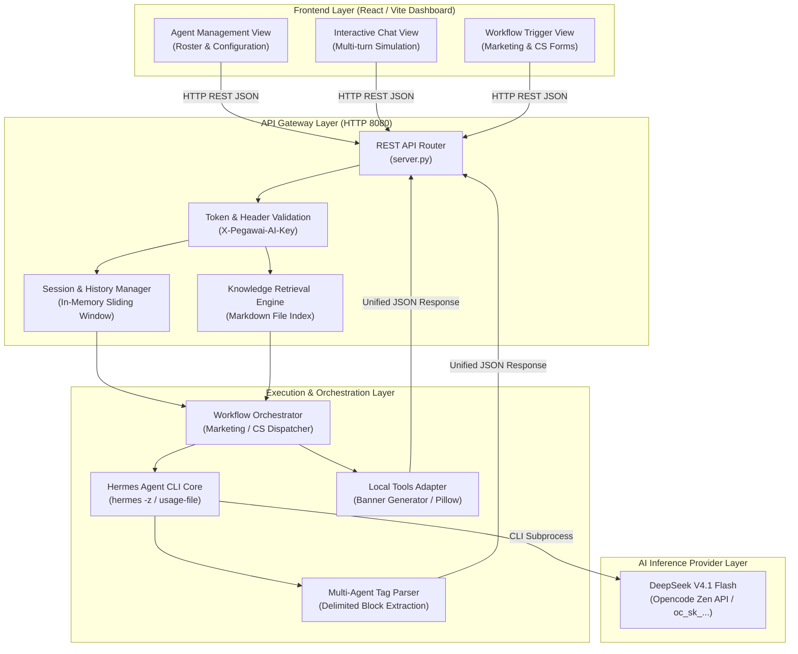

# S3-01B: Hermes Agent Management Platform Architecture & API Contract v1

**Sprint:** Sprint 3 — Day 1 (November 5, 2026)  
**Task Title:** Define Platform Architecture and API Contracts  
**Assignee:** Intern 1 (Backend & Platform Lead)  
**Collaboration Activity:** Companion to S3-01A Foundation Review ([ClickUp Task z8xxqwefqm](https://app.clickup.com/t/z8xxqwefqm))  
**Package Budget:** 6 Focused Hours (Joint Architecture Definition, Contract Alignment & Handoff)  
**Status:** COMPLETE (Architecture Defined, API Contract v1 Agreed, Schemas Specified, Roadmap Sequenced)  

---

## 1. Executive Summary & Architectural Scope

Dokumen ini menetapkan spesifikasi teknis resmi untuk **Hermes Agent Management Platform Architecture** dan **API Contract v1** yang menghubungkan backend dengan Frontend. 

Arsitektur ini dibangun di atas fondasi yang telah diverifikasi pada Sprint 2 dan dievaluasi pada task S3-01A:
* **LLM Engine:** Hermes Agent CLI `v0.22.2` menjalankan model **DeepSeek V4.1 Flash** (`deepseek-v4.1-flash`) melalui provider `opencode` (Opencode Zen) dengan zero model substitution.
* **Bisnis Percontohan:** Dua karyawan AI otonom untuk brand retail fashion **Colorbox** (PT Delamibrands Kharisma Busana):
  1. **Colorbox Marketing AI Employee:** Alur kerja 5-tahap (*Brief $\rightarrow$ Planning $\rightarrow$ Generation $\rightarrow$ Brand Review $\rightarrow$ Revision*).
  2. **Colorbox Customer Service (CS) AI Employee:** Alur kerja 5-tahap (*Inquiry $\rightarrow$ Classification $\rightarrow$ Knowledge Retrieval $\rightarrow$ Draft $\rightarrow$ Escalation*).

### Batasan Kritis (Operating Boundaries):
1. **R&D Prototype Only:** Tanpa database multi-tenant production, sistem auth kompleks (OAuth/JWT), atau payment gateway.
2. **Strict Public Data Separation:** Menggunakan fakta publik terverifikasi (SOP penukaran produk retail 7 hari), asumsi bisnis berlabel, dan data dummy sintetis (`#CBX-2026-9812`).
3. **No Live External Access:** Tidak ada integrasi live ke Shopee Mall API, Instagram Graph API, sistem ERP internal SAP, atau pengiriman pesan langsung ke customer nyata.
4. **Human-in-the-Loop:** Semua luaran berstatus *DRAFT* yang memerlukan tinjauan manusia (*Human Review*) sebelum publikasi.

---

## 2. Diagram Arsitektur Platform Hermes



---

## 3. Matriks Kelayakan & Ketergantungan Kapabilitas Platform

Berikut adalah status kelayakan teknis per kapabilitas platform Hermes berdasarkan audit S3-01A dan penetapan prioritas implementasi:

| Kapabilitas Platform | Status Kelayakan | Penjelasan Teknis & Batasan | Prioritas Implementasi |
| :--- | :--- | :--- | :--- |
| **Agent Management (CRUD)** | **MOCKED (Prototype Store)** | Daftar agen, peran, avatar, dan konfigurasi dikelola via file konfigurasi lokal `agents.json`. Cukup untuk prototype tanpa DB SQL berat. | **Tier 1 (Core - Nov 6)** |
| **Interactive Chat & Session** | **WORKING (Core)**<br>**ADAPTER (Memory)** | Eksekusi single-turn via Hermes CLI terbukti stabil. Backend mengelola array sesi (sliding window 3-5 percakapan) dan menginjeksinya ke prompt. | **Tier 1 (Core - Nov 6)** |
| **Tools / Plugins Registry** | **MOCKED / LOCAL** | Pembuatan banner gambar dikerjakan oleh script Python lokal (`Pillow`). Tool dynamic registration bawaan Hermes di-bypass demi stabilitas. | **Tier 2 (Supported Adapter)** |
| **Integration Connection States**| **WORKING** | Endpoint `/health` secara realtime memverifikasi binary Hermes, ketersediaan provider, dan status koneksi API key. | **Tier 1 (Core - Nov 6)** |
| **Computer Use (GUI OS)** | **UNSUPPORTED** | Hermes CLI di Windows tidak memiliki kapabilitas Computer Use. Tidak diperlukan untuk alur kerja teks dan konten fashion Colorbox. | **Excluded / Out of Scope** |
| **Scheduler Job Management** | **MOCKED / BACKEND ADAPTER** | Hermes tidak memiliki background scheduler bawaan. Dikelola oleh modul timer backend (`threading.Timer` / lightweight cron). | **Tier 2 (Prototype Nov 9)** |
| **Activity & Execution Status** | **WORKING** | Penangkapan metrik token input/output via `--usage-file usage.json`, status proses exit code, dan durasi latensi telah terverifikasi. | **Tier 1 (Core - Nov 6)** |

---

## 4. Knowledge Retrieval Berbasis Sumber & Penanganan Kasus

Sistem tidak memerlukan vector database kompleks (seperti Pinecone/Milvus) untuk tahap prototype. Pengetahuan dikelola menggunakan **File-Based Indexing** di folder `local_setup/backend_template/context/sops/`.

### Struktur Pelabelan Pengetahuan:
1. `[VERIFIED_FACT]`: Informasi publik resmi Colorbox.
   * *Contoh:* Kebijakan penukaran ukuran maksimal 7 hari kalender sejak pembelian; wajib struk asli dan tag harga utuh; tidak berlaku untuk underwear.
2. `[ASSUMED_POLICY]`: Kebijakan bisnis standar ritel pakaian.
   * *Contoh:* Estimasi pengiriman reguler 2–5 hari kerja (Jabodetabek) dan 3–7 hari kerja (Luar Jawa); jam operasional toko 10.00 – 22.00 WIB.
3. `[DUMMY_SIMULATION]`: Data sintetis untuk kebutuhan pengujian.
   * *Contoh:* Nomor pesanan `#CBX-2026-9812`, nomor resi dummy `JNE-CBX-88129031`.

### Penanganan Pengetahuan Tidak Ditemukan / Konflik (*Missing & Conflicting Knowledge*):
* **Jika Pengetahuan Hilang / Tidak Ada di SOP:**
  * AI dilarang keras mengarang jawaban (*zero hallucination*).
  * Sistem mengembalikan kode `KNOWLEDGE_NOT_FOUND`.
  * AI menghasilkan draf jawaban sopan: *"Mohon maaf Kak, untuk pertanyaan khusus terkait hal ini, pesan Kakak kami teruskan ke Team Leader Customer Service kami untuk penanganan lebih lanjut."*
  * Status tiket otomatis diubah menjadi `ESCALATED_TO_SUPERVISOR`.
* **Jika Terjadi Konflik Antar Dokumen:**
  * Dokumen spesifik divisi (`colorbox_cs_sop.md`) mengesampingkan panduan umum (`company_profile.md`).

---

## 5. Spesifikasi Alur Bisnis Colorbox & Skema Luaran Terstruktur

### A. Colorbox Marketing Workflow
Alur kerja pembuatan paket konten promosi busana Colorbox terdiri dari 5 tahapan terstruktur:
1. **Input:** Tema kampanye, pilar konten, target channel (Instagram/TikTok), opsi sertakan visual.
2. **Planning:** 3 usulan ide pilar konten dan jadwal kalender publikasi optimal.
3. **Generation:** 
   * Naskah utama berformula AIDA (*Attention, Interest, Desire, Action*).
   * Gaya bahasa: *Gen-Z friendly, expressive, cheerful, approachable*.
   * Call to Action (CTA) dan 5–7 tagar relevan (`#ColorboxBabes`, `#OOTDColorbox`).
   * 1 naskah alternatif yang lebih ringkas.
4. **Brand & Claim Review:**
   * Skor kepatuhan brand (0–100).
   * Audit *Brand Voice* & verifikasi klaim (*zero misleading claims*).
5. **Revision & Visual Concept:**
   * Arahan perbaikan naskah.
   * Prompt gambar Midjourney/DALL-E 3 dalam bahasa Inggris + palet warna heksadesimal.

### B. Colorbox Customer Service (CS) Workflow
Alur kerja interaktif untuk penanganan pertanyaan dan simulasi keluhan pelanggan ritel:
1. **Inquiry:** Pesan masuk dari pelanggan (misal: penukaran ukuran, barang cacat, pesanan telat).
2. **Intent Classification:** Klasifikasi niat (`SIZE_EXCHANGE`, `DELIVERY_DELAY`, `DEFECTIVE_PRODUCT`, `PROMO_INQUIRY`, `REFUND_REQUEST`), sentimen (`POSITIVE`, `NEUTRAL`, `NEGATIVE`), dan urgensi (`LOW`, `MEDIUM`, `HIGH`, `CRITICAL`).
3. **Knowledge Retrieval:** Mengambil pasal SOP terkait syarat 7 hari retur, kondisi tag harga, dan struk pembelian.
4. **Response Draft:** Jawaban empatik, ramah, dan solutif yang meminta informasi pendukung (nomor order dummy, foto produk).
5. **Escalation & Ticket Management:** Ringkasan tiket, rekomendasi eskalasi (*Human Takeover* jika komplain berat), dan ID tiket unik.

---

## 6. Agreed API Contract v1 (Backend $\leftrightarrow$ Frontend)

Kontrak API v1 ini disepakati bersama tim Frontend sebagai acuan resmi komunikasi antarmuka:

### Ringkasan Endpoint

| Endpoint | Method | Fungsi | Kategori |
| :--- | :--- | :--- | :--- |
| `/api/v1/health` | `GET` | Memeriksa ketersediaan server, binary Hermes, dan provider | Core Health |
| `/api/v1/agents` | `GET` | Mendapatkan daftar seluruh karyawan AI yang terdaftar | Agent Management |
| `/api/v1/agents/{agent_id}` | `GET` | Mendapatkan konfigurasi dan detail persona satu karyawan AI | Agent Management |
| `/api/v1/chat/message` | `POST` | Mengirim pesan dalam percakapan interaktif (multi-turn) | Interactive Chat |
| `/api/v1/chat/sessions/{session_id}/reset` | `POST` | Mereset riwayat percakapan sesi tertentu | Interactive Chat |
| `/api/v1/workflows/marketing/run` | `POST` | Mengeksekusi pipeline 5-tahap Marketing Colorbox | Business Workflow |
| `/api/v1/workflows/cs/run` | `POST` | Mengeksekusi pipeline analisis & draf CS Colorbox | Business Workflow |
| `/api/v1/knowledge/lookup` | `GET` | Mencari pasal SOP Colorbox berdasarkan kata kunci | Knowledge Base |

---

### Format Header Standar
Setiap request mewajibkan header keamanan berikut:
```http
Content-Type: application/json
X-Pegawai-AI-Key: dev-pegawai-ai-2026
```

---

### Contoh Request & Response Eksak

#### 1. Eksekusi Workflow Marketing (`POST /api/v1/workflows/marketing/run`)
**Request Body:**
```json
{
  "client_id": "cbx_indonesia_retail",
  "campaign_brief": "Koleksi Summer Pastel Series 2026 untuk Remaja Putri",
  "content_type": "instagram_carousel",
  "target_channel": "instagram",
  "include_visual_concept": true
}
```

**Response Body (`200 OK`):**
```json
{
  "status": "success",
  "run_id": "run_mkt_20261105_001",
  "workflow_id": "wf_colorbox_marketing_v1",
  "execution_duration_sec": 38.45,
  "usage": {
    "prompt_tokens": 760,
    "completion_tokens": 1050,
    "total_tokens": 1810
  },
  "data": {
    "planning": {
      "campaign_theme": "Summer Pastel Chic 2026",
      "content_pillar": "OOTD Inspiration & Mix and Match",
      "recommended_publish_time": "Jumat, 18.30 WIB"
    },
    "generation": {
      "primary_copy": "Sambut liburan dengan warna pastel yang bikin ceria! 🌸 Koleksi Summer Pastel dari Colorbox hadir dengan potongan loose-fit yang adem dan nyaman dipakai seharian. Dari crop shirt sampai pleated skirt, bikin OOTD kamu auto-fresh tanpa ribet! Swipe left buat lihat rekomendasi styling favorit minggu ini ✨",
      "call_to_action": "Kunjungi store Colorbox terdekat atau checkout langsung di link bio ya Babes!",
      "hashtags": ["#ColorboxBabes", "#ColorboxPastel", "#OOTDRemaja", "#FashionGenZ", "#SummerVibes"],
      "copy_alternative": "Anti ribet, tetap aesthetic! Upgrade look santai kamu dengan koleksi Summer Pastel Colorbox. Stylish, adem, dan ramah kantong!"
    },
    "brand_review": {
      "compliance_score": 95,
      "tone_audit": "PASSED (Cheerful, energetic, approachable)",
      "claim_verification": "PASSED (Klaim bahan dan harga wajar)",
      "recommendations": "Gunakan visual dengan pencahayaan natural hangat untuk menonjolkan warna pastel."
    },
    "visual_concept": {
      "layout_mood": "Bright pastel studio, soft pink & lilac accents, clean playful layout",
      "color_palette": ["#FFD1DC", "#C8A2C8", "#FFFFFF"],
      "image_prompt_en": "Fashion editorial photography, smiling young Indonesian woman wearing lilac cotton shirt and pastel sunglasses, cheerful aesthetic background, soft studio lighting, 4k",
      "image_url": "/api/v1/assets/banner_cbx_pastel.png"
    },
    "status": "DRAFT_READY_FOR_HUMAN_REVIEW"
  }
}
```

---

#### 2. Percakapan Interaktif CS Multi-Turn (`POST /api/v1/chat/message`)
**Request Body:**
```json
{
  "session_id": "sess_cbx_08912",
  "agent_id": "ag_colorbox_cs",
  "customer_name": "Salsa",
  "message": "Halo min, pesanan saya nomor #CBX-2026-9812 udah 5 hari kok belum sampai ya?",
  "channel": "whatsapp_simulation"
}
```

**Response Body (`200 OK`):**
```json
{
  "status": "success",
  "session_id": "sess_cbx_08912",
  "turn_number": 1,
  "execution_duration_sec": 18.20,
  "classification": {
    "intent": "DELIVERY_DELAY",
    "sentiment": "NEGATIVE_MILD",
    "urgency": "MEDIUM",
    "extracted_entities": {
      "order_number": "#CBX-2026-9812",
      "delay_days": 5
    }
  },
  "knowledge_applied": {
    "sop_ref": "SOP-CBX-LOG-02 (Standar Layanan Ekspedisi & Kendala Pengiriman)",
    "standard_sla": "2-5 hari kerja untuk wilayah Jabodetabek",
    "action_required": "Verifikasi status resi pada ekspedisi rekanan"
  },
  "response": "Halo Kak Salsa! Terima kasih sudah menghubungi Colorbox. Mohon maaf sekali atas ketidaknyamanan terkait keterlambatan pengiriman pesanan Kakak dengan nomor #CBX-2026-9812 ya Kak. Tim kami saat ini sedang melakukan pengecekan langsung ke pihak ekspedisi terkait posisi paket Kakak. Boleh dibantu kota tujuan pengiriman Kakak saat pemesanan?",
  "ticket_management": {
    "ticket_id": "TKT-CBX-00412",
    "priority": "HIGH",
    "status": "WAITING_COURIER_TRACE",
    "requires_escalation": false
  }
}
```

---

#### 3. Error Semantics & Fallback Contract
Jika terjadi kesalahan validasi atau gangguan layanan:
```json
{
  "status": "error",
  "error_code": "ERR_VALIDATION_MISSING_FIELD",
  "message": "Field 'message' wajib diisi dan tidak boleh berupa string kosong.",
  "timestamp": "2026-11-05T14:30:00Z"
}
```

Jika model AI mengalami timeout:
```json
{
  "status": "error",
  "error_code": "ERR_MODEL_TIMEOUT",
  "message": "Inference model melebihi batas waktu 180 detik.",
  "fallback_action": "RETRY_WITH_BACKOFF",
  "timestamp": "2026-11-05T14:32:00Z"
}
```

---

## 7. Roadmap Implementasi & Tahapan Serah Terima (Sequencing)

Alur pengerjaan teknis dibagi secara bertahap agar pengujian bisnis tidak terhambat oleh pengembangan tampilan:

```
+-----------------------------------------------------------------------------------+
|                        SPRINT 3 IMPLEMENTATION TIMELINE                           |
+-----------------------------------------------------------------------------------+
|  5 November (Hari Ini - Day 1) : Platform Architecture & Contract v1 [SELESAI]   |
|  - Spesifikasi arsitektur platform Hermes Agent Management                        |
|  - Kesepakatan API Contract v1 dengan Frontend                                   |
|  - Matriks kelayakan dan pemetaan 2 karyawan AI Colorbox                          |
+-----------------------------------------+-----------------------------------------+
                                          | Handoff ke Day 2
                                          v
+-----------------------------------------------------------------------------------+
|  6 November (Besok - Day 2)    : Core Backend APIs Implementation                 |
|  - Penambahan rute /api/v1/workflows/marketing/run & /api/v1/chat/message        |
|  - Penyusunan context SOP resmi Colorbox (Markdown files)                         |
|  - Implementasi in-memory session memory adapter untuk CS multi-turn              |
+-----------------------------------------+-----------------------------------------+
                                          | Handoff ke Day 3
                                          v
+-----------------------------------------------------------------------------------+
|  9 November (Senin - Day 3)    : Supported Adapters & Business Testing            |
|  - Backend siap diuji langsung oleh Business Owners (tanpa menunggu UI final)    |
|  - Verifikasi fallback knowledge missing dan eskalasi supervisor                  |
|  - Penyerahan adapter tambahan ke tim Frontend secara inkremental                 |
+-----------------------------------------+-----------------------------------------+
                                          | Handoff ke Day 4
                                          v
+-----------------------------------------------------------------------------------+
|  10 November (Selasa - Day 4)  : Final UI Integration & Validation Demonstration  |
|  - Integrasi antarmuka dashboard React/Vite dengan Backend API v1                 |
|  - Demo end-to-end traversal lengkap untuk Marketing dan CS                      |
|  - Penyerahan dokumentasi handover teknis akhir (S3-04A)                          |
+-----------------------------------------------------------------------------------+
```

---

## 8. Verifikasi Kriteria Keberhasilan (Acceptance Criteria Checklist)

- [x] **Agent Management & Chat Architecture:** Ditetapkan operasi list/view/execute, konfigurasi agen, dan pemisahan konteks percakapan tanpa ketergantungan DB production.
- [x] **Platform Capability Feasibility:** Evaluasi kapabilitas (Working, Mocked, Unsupported, Blocked) terdokumentasi dengan bukti teknis nyata.
- [x] **Business Workflow Fields:** Skema luaran Marketing (5 tahap) dan CS (5 tahap) didefinisikan lengkap dengan perilaku saat data/knowledge hilang.
- [x] **API Contract v1 Agreement:** Kontrak endpoint, format header, request/response JSON, dan semantik error disepakati bersama Frontend.
- [x] **Implementation Sequencing:** Jadwal rilis bertahap (Core 6 Nov, Business Test 9 Nov, Final UI 10 Nov) terdokumentasi jelas.

