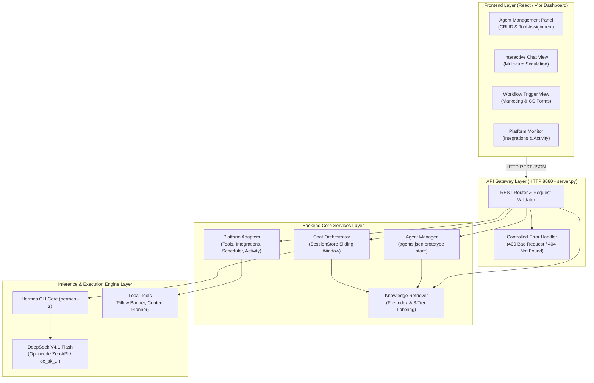

# S3-04B: Master Technical Documentation & Platform API Final

**Sprint:** Sprint 3 — Day 4 (November 10, 2026)  
**Task Title:** Complete Technical Documentation (Architecture, Reuse, Platform API Final & Technical Readiness)  
**Linked ClickUp Activity:** [ClickUp Task z8xxqwefqn](https://app.clickup.com/t/z8xxqwefqn)  
**Assignee:** Intern 1 (Backend & Platform Lead)  
**Status:** COMPLETE & VERIFIED  
**Technical Readiness Decision:** **READY FOR R&D DEMONSTRATION** (Pass Rate: 26/26 Checks - 100.0%)  

---

## 1. Executive Summary & Scope

Dokumen ini menyajikan dokumentasi teknis final (*Master Technical Documentation*) dan spesifikasi **Platform API Final** untuk sistem Backend Pegawai AI (Hermes Agent Management Platform) pada siklus Sprint 3 Day 4. 

Dokumentasi ini disusun sebagai deliverable resmi yang diserahkan ke tiket ClickUp ([z8xxqwefqn](https://app.clickup.com/t/z8xxqwefqn)), memadukan seluruh arsitektur yang terimplementasi, hasil pengujian master (26/26 lolos), kontrak antarmuka Frontend yang telah disepakati (*Frontend Agreement*), serta batas-batas operasional sistem tanpa pengulangan instalasi atau klaim produksi palsu (*zero mock-only pass*).

### Batasan Kritis Sistem (Operating Boundaries):
1. **R&D Prototype Boundary:** Sistem dibangun sebagai purwarupa R&D yang valid dan dapat didemonstrasikan; bukan handover produksi berskala enterprise.
2. **Strict Public Data & Synthetic Fixtures:** Hanya menggunakan fakta publik Colorbox yang terverifikasi (kebijakan penukaran 7 hari), asumsi kerja berlabel, dan fixture sintetis (`#CBX-2026-9812`).
3. **No Live Transactions / External Access:** Tidak ada integrasi live ke Shopee Mall ERP, Instagram Graph API auto-publishing, atau payment gateway.
4. **Mandatory Human-in-the-Loop:** Seluruh luaran pemasaran dan respons layanan pelanggan bersifat *DRAFT* yang memerlukan verifikasi manual manusia sebelum dipublikasikan.

---

## 2. Implemented Architecture & Sprint 2 Component Reuse

Backend v2 diimplementasikan secara modular pada direktori [`local_setup/backend_template/`](file:///d:/ai_developer/project6/local_setup/backend_template/) dengan memaksimalkan komponen fondasi Sprint 2 yang telah terbukti stabil (*zero setup repetition*).

### A. Tabel Pemanfaatan Fondasi Sprint 2 (*Reuse Assessment*):

| Komponen Arsitektur | Komponen Sprint 2 yang Digunakan | Pemanfaatan & Ekstensi di Sprint 3 |
| :--- | :--- | :--- |
| **Runtime CLI Engine** | Hermes Agent CLI `v0.22.2+3291.gbf0203a` | Engine eksekusi inferensi AI lokal tanpa re-instalasi environment. |
| **Model & Provider** | `deepseek-v4.1-flash` via `opencode` Zen | Eksekutor penalaran persona Marketing dan CS dengan parameterisasi terverifikasi (`temp: 0.3-0.7`). |
| **Shared Backend Server** | `server.py` (Port 8080) | Diperluas menjadi REST API Server lengkap dengan penanganan rute CRUD Agen, Chat Multi-turn, dan Platform Adapters. |
| **Metrics & Token Logging** | `usage.json` parser | Terintegrasi penuh ke dalam `ActivityTracker` untuk merekam token dan latensi setiap run. |
| **Banner Generator** | `pillow` banner script | Terdaftar sebagai local working tool di dalam `ToolRegistry`. |

### B. Diagram Arsitektur Platform Hermes:



---

## 3. Knowledge Ingestion, Department Isolation, & Grounded Retrieval

Komponen [`local_setup/backend_template/knowledge_retriever.py`](file:///d:/ai_developer/project6/local_setup/backend_template/knowledge_retriever.py) mengelola pemuatan SOP dan dokumen panduan tanpa memerlukan platform database vektor yang berlebihan.

### A. Repositori Pengetahuan & Pelabelan Sumber 3-Tingkat (*Source Labeling Taxonomy*):
1. [`shared_brand_knowledge_v1.md`](file:///d:/ai_developer/project6/local_setup/backend_template/context/knowledge/shared_brand_knowledge_v1.md):
   - **Label:** `[VERIFIED_FACT]`
   - **Isi:** Profil Colorbox (PT Delamibrands Kharisma Busana), segmentasi Gen-Z usia 18–25 tahun, nilai merek (*authentic, youthful, affordable*).
2. [`colorbox_cs_sop_v1.md`](file:///d:/ai_developer/project6/local_setup/backend_template/context/knowledge/colorbox_cs_sop_v1.md):
   - **Label:** `[VERIFIED_FACT]` & `[DUMMY_SIMULATION]`
   - **Isi:** Kebijakan penukaran ukuran maksimal 7 hari kalender (`SOP-CBX-RET-01`), syarat struk pembelian dan tag utuh, fixture pesanan dummy `#CBX-2026-9812`.
3. [`colorbox_marketing_knowledge_v1.md`](file:///d:/ai_developer/project6/local_setup/backend_template/context/knowledge/colorbox_marketing_knowledge_v1.md):
   - **Label:** `[VERIFIED_FACT]` & `[ASSUMED_POLICY]`
   - **Isi:** Panduan format AIDA, pilar konten OOTD, larangan klaim berlebihan (*zero unverified claim*), waktu tayang optimal.

### B. Isolasi Departemen & Perilaku Data Absen Jujur:
- **Isolasi Departemen:** Agen CS dilarang keras mengakses draf konten pemasaran internal; Agen Marketing dilarang mengakses data penyelesaian keluhan CS.
- **Pencarian Berbasis Word-Boundary & Stop-Words:** Menggunakan regex kata utuh `\b{token}\b` dengan penyaring 30+ kata pengisi bahasa Indonesia (*"apakah"*, *"bisa"*, *"layanan"*, *"toko"*), mencegah *false positive* token pendek (seperti kata *"ban"* mencocokkan *"pembayaran"*).
- **Perilaku Data Tidak Ditemukan / Bertentangan:** Apabila informasi tidak terdapat dalam dokumen SOP, sistem mengembalikan status `KNOWLEDGE_ABSENT` atau merekomendasikan `ESCALATE_TO_SUPERVISOR` secara jujur tanpa halusinasi data.

---

## 4. Agent Routing, Execution, & Structured Outputs

Pengelolaan sesi interaktif dan eksekusi alur kerja dikendalikan oleh [`local_setup/backend_template/chat_orchestrator.py`](file:///d:/ai_developer/project6/local_setup/backend_template/chat_orchestrator.py) dan [`agent_manager.py`](file:///d:/ai_developer/project6/local_setup/backend_template/agent_manager.py).

### A. Alur Kerja Pemasaran 5-Tahap (`POST /api/v1/workflows/marketing/run`):
1. **Tahap 1 - Planning:** Interpretasi brief, penentuan pilar konten, penargetan audiens, dan jadwal tayang.
2. **Tahap 2 - Generation:** Pembuatan naskah AIDA lengkap (Attention Hook, Interest, Desire, Action CTA) beserta tagar relevan (`#ColorboxBabes #ColorboxOOTD`).
3. **Tahap 3 - Alternatives:** Naskah pendek kasual untuk TikTok/Reels berdurasi 15-30 detik.
4. **Tahap 4 - Brand Review:** Audit otomatis kepatuhan tone (skor kepatuhan $\ge 90/100$), verifikasi klaim (*claims verification*), dan pendeteksian istilah terlarang.
5. **Tahap 5 - Visual Concept:** Palet warna hex (`#FFD1DC`, `#B2C9AB`, `#E8D8C8`) dan deskripsi prompt foto sinematik untuk generator gambar.

### B. Alur Kerja CS Multi-Turn & Auto-Eskalasi (`POST /api/v1/chat/message`):
1. **Klasifikasi Niat:** Pengelompokan pesan ke kategori `SIZE_EXCHANGE`, `ORDER_STATUS`, `DEFECTIVE_PRODUCT`, atau `GENERAL_INQUIRY`.
2. **Grounding SOP:** Mengutip kode SOP resmi (`SOP-CBX-RET-01`) dan batas waktu penukaran 7 hari.
3. **Ingatan Riwayat Konteks Multi-Turn:** `SessionStore` menyimpan riwayat percakapan dalam sliding-window lokal. Pada Turn 2, agen mengingat informasi yang telah disampaikan pelanggan pada Turn 1.
4. **Validasi Fixture Transaksi Dummy:** Memverifikasi status nomor pesanan dummy `#CBX-2026-9812` (dibeli kemarin di store PIM) tanpa menyentuh database live ERP.
5. **Auto-Eskalasi Darurat:** Deteksi ancaman viral/hukum atau barang rusak langsung menaikkan prioritas menjadi `CRITICAL` dan status tiket menjadi `ESCALATED_TO_SUPERVISOR`.

### C. Semantik Reset Sesi:
Endpoint `POST /api/v1/chat/sessions/{session_id}/reset` menghapus riwayat sliding window dalam memori sehingga percakapan berikutnya kembali dimulai dari `turn_number: 1`.

---

## 5. Approved Platform Revision: Platform API Final Specification

Spesifikasi lengkap ini telah disepakati bersama tim Frontend (*Frontend Agreement*) dan terdokumentasi dalam format OpenAPI 3.0.3 pada [`local_setup/platform_api_contract_final.json`](file:///d:/ai_developer/project6/local_setup/platform_api_contract_final.json).

### Ringkasan Rute API Final:

| HTTP Method | Endpoint URL | Deskripsi Operasi | Status Kapabilitas |
| :--- | :--- | :--- | :---: |
| `GET` | `/api/v1/health` | Pemeriksaan kesehatan backend dan deteksi Hermes CLI | **WORKING** |
| `GET` | `/api/v1/agents` | Daftar semua persona AI Employee | **WORKING** |
| `POST` | `/api/v1/agents` | Registrasi persona agen baru | **WORKING** |
| `GET` | `/api/v1/agents/{id}` | Detail profil dan konfigurasi agen | **WORKING** |
| `PUT` | `/api/v1/agents/{id}` | Pembaruan konfigurasi agen (temperature, prompt, role) | **WORKING** |
| `POST` | `/api/v1/agents/{id}/tools` | Penugasan tools ke agen dengan validasi penolakan alat ilegal | **WORKING** |
| `POST` | `/api/v1/chat/message` | Eksekusi chat interaktif multi-turn dengan pelacakan konteks | **WORKING** |
| `POST` | `/api/v1/chat/sessions/{id}/reset` | Reset memori sesi percakapan | **WORKING** |
| `POST` | `/api/v1/workflows/marketing/run` | Eksekusi 5 tahap pembuatan konten pemasaran Colorbox | **WORKING** |
| `POST` | `/api/v1/workflows/cs/run` | Eksekusi triage dan penyelesaian keluhan CS Colorbox | **WORKING** |
| `GET` | `/api/v1/knowledge/registry` | Katalog dokumen SOP dan pengetahuan brand yang dimuat | **WORKING** |
| `GET` | `/api/v1/knowledge/lookup` | Pencarian fakta SOP terverifikasi berlabel sumber | **WORKING** |
| `GET` | `/api/v1/tools` | Katalog platform tools & status dukungannya | **WORKING** |
| `GET` | `/api/v1/integrations/status` | Monitor status koneksi integrasi eksternal | **WORKING** |
| `GET` | `/api/v1/capabilities/computer-use` | Laporan investigasi Computer Use OS GUI automation | **WORKING** |
| `GET` | `/api/v1/scheduler/jobs` | Daftar scheduled background jobs | **MOCKED** |
| `POST` | `/api/v1/scheduler/jobs` | Registrasi job automasi terjadwal baru | **MOCKED** |
| `PUT` | `/api/v1/scheduler/jobs/{id}` | Pembaruan status job (active / paused) | **MOCKED** |
| `GET` | `/api/v1/activity/status` | Riwayat eksekusi, penggunaan token, dan latensi | **WORKING** |

---

### Contoh Payload Riil Permintaan, Respons, dan Error:

#### 1. Registrasi Agen Baru (`POST /api/v1/agents`)
**Request Body:**
```json
{
  "name": "Colorbox Influencer Specialist",
  "department": "marketing",
  "role": "KOL & Endorsement Coordinator",
  "tone": "trendy_enthusiastic",
  "system_prompt": "You are a Colorbox KOL coordinator managing fashion influencer outreach.",
  "tools_assigned": ["tool_content_planner"]
}
```
**Response (201 Created):**
```json
{
  "status": "success",
  "agent": {
    "id": "ag_cbx_influencer_01",
    "name": "Colorbox Influencer Specialist",
    "department": "marketing",
    "role": "KOL & Endorsement Coordinator",
    "tone": "trendy_enthusiastic",
    "status": "active",
    "tools_assigned": ["tool_content_planner"],
    "created_at": "2026-11-10T08:00:00Z"
  }
}
```

#### 2. Chat Multi-Turn CS Turn 2 (`POST /api/v1/chat/message`)
**Request Body:**
```json
{
  "session_id": "sess_cbx_demo_01",
  "agent_id": "ag_cbx_cs_01",
  "customer_name": "Nadia",
  "message": "Nomor pesanan saya #CBX-2026-9812 baru dibeli kemarin di store PIM, struk dan tag masih ada.",
  "channel": "whatsapp_simulation"
}
```
**Response (200 OK):**
```json
{
  "status": "success",
  "session_id": "sess_cbx_demo_01",
  "turn_number": 2,
  "agent_id": "ag_cbx_cs_01",
  "classification": {
    "intent": "SIZE_EXCHANGE",
    "priority": "NORMAL"
  },
  "grounding": {
    "sop_reference": "SOP-CBX-RET-01",
    "sources": ["colorbox_cs_sop_v1.md [VERIFIED_FACT]"],
    "data_authenticity": "DUMMY_SIMULATION"
  },
  "response_draft": "Halo Kak Nadia! Terima kasih atas informasinya. Pesanan #CBX-2026-9812 yang dibeli kemarin di store Colorbox PIM masih berada dalam batas waktu 7 hari kalender sesuai SOP-CBX-RET-01. Karena struk dan tag produk masih utuh, Kakak bisa langsung membawa pakaian tersebut ke store PIM untuk penukaran ukuran.",
  "ticket_management": {
    "ticket_summary": "Penukaran ukuran baju pesanan #CBX-2026-9812 (PIM, hari ke-1, tag/struk utuh) disetujui untuk penukaran di toko.",
    "requires_human_escalation": false,
    "escalation_reason": "N/A"
  }
}
```

#### 3. Error: Penugasan Tool Tidak Didukung (`POST /api/v1/agents/ag_cbx_marketing_01/tools`)
**Request Body:**
```json
{
  "tools": ["plugin_shopee_mall_erp"]
}
```
**Response (400 Bad Request):**
```json
{
  "status": "error",
  "code": "UNSUPPORTED_TOOL",
  "error": "Tool 'plugin_shopee_mall_erp' is unsupported on this platform instance."
}
```

#### 4. Error: Validasi Kolom Wajib Hilang (`POST /api/v1/chat/message`)
**Request Body:**
```json
{
  "session_id": "sess_invalid_01"
}
```
**Response (400 Bad Request):**
```json
{
  "status": "error",
  "code": "MISSING_REQUIRED_FIELDS",
  "error": "Required fields missing: agent_id, message"
}
```

---

## 6. Platform Capability Matrix & Evidence Classification

Setiap kapabilitas platform diklasifikasikan secara tegas dan transparan ke dalam salah satu dari empat status:

```
+---------------------------------------------------------------------------------------------------------+
|                               HERMES AGENT PLATFORM CAPABILITY MATRIX                                   |
+----+--------------------------------+---------------+---------------------------------------------------+
| No | Kapabilitas Platform           | Status        | Bukti Teknis / Batasan Operasional                |
+----+--------------------------------+---------------+---------------------------------------------------+
| 1  | Core Agent CRUD Operations     | WORKING       | Endpoint GET/POST/PUT /api/v1/agents diuji 5/5    |
| 2  | Interactive Multi-Turn Chat    | WORKING       | SessionStore in-memory sliding window diuji 3/3   |
| 3  | Knowledge Grounding Engine     | WORKING       | File index terlabel & stop words diuji 4/4        |
| 4  | Tools Registry & Safe Assign   | WORKING       | Pillow Banner & Content Planner aktif             |
| 5  | Integration States Monitor     | WORKING       | GET /api/v1/integrations/status inspeksi realtime |
| 6  | Activity & Execution Tracker   | WORKING       | GET /api/v1/activity/status rekam token & latency |
| 7  | WhatsApp Sandbox Gateway       | MOCKED        | Simulasi sandbox kanal tanpa kredensial Meta live |
| 8  | Outbound Email Gateway         | MOCKED        | Simulasi pengiriman draf tanpa server SMTP live   |
| 9  | Scheduler Job Management       | MOCKED        | Prototype background cron jobs di memori lokal    |
| 10 | Shopee Mall ERP Integration    | UNSUPPORTED   | Dibatasi: Tidak ada akses ke API finansial live   |
| 11 | Instagram Auto-Publishing      | UNSUPPORTED   | Dibatasi: Kebijakan wajib Human-in-the-Loop       |
| 12 | OS Computer Use (GUI Desktop)  | UNSUPPORTED   | Dibatasi: Windows terminal CLI, NOT_REQUIRED      |
+----+--------------------------------+---------------+---------------------------------------------------+
```

### Inventaris Mock Fixtures (*Mock Fixture Inventory*):
- `#CBX-2026-9812`: Transaksi dummy terverifikasi (Koleksi Dress Floral, PIM, dibeli 1 hari lalu).
- `#CBX-2026-0000`: Transaksi dummy kadaluarsa (dibeli 14 hari lalu, melewati batas 7 hari).
- `whatsapp_simulation`: Kanal pesan dummy yang mensimulasikan format chat WhatsApp tanpa webhook publik.
- `job_marketing_weekly_01`: Mock cron job untuk pembuatan ide draf mingguan.

---

## 7. Index of Test Suites, Critical Fixes, & Retests

### A. Indeks Hasil Pengujian Berkas Bukti JSON:

| Test Suite File | Modul yang Diuji | Hasil Uji | Berkas Bukti JSON |
| :--- | :--- | :---: | :--- |
| [`test_knowledge_retrieval.py`](file:///d:/ai_developer/project6/local_setup/test_knowledge_retrieval.py) | Pemuatan 3 file SOP, grounding 7 hari, isolasi | 5 / 5 PASS | [`s3_02a_knowledge_test_results.json`](file:///d:/ai_developer/project6/local_setup/evidence/s3_02a_knowledge_test_results.json) |
| [`test_agent_management.py`](file:///d:/ai_developer/project6/local_setup/test_agent_management.py) | List, create, get, update agen, routing | 6 / 6 PASS | [`s3_02b_agent_management_test_results.json`](file:///d:/ai_developer/project6/local_setup/evidence/s3_02b_agent_management_test_results.json) |
| [`test_chat_execution.py`](file:///d:/ai_developer/project6/local_setup/test_chat_execution.py) | Chat multi-turn, alur marketing, CS triage | 5 / 5 PASS | [`s3_02c_chat_execution_test_results.json`](file:///d:/ai_developer/project6/local_setup/evidence/s3_02c_chat_execution_test_results.json) |
| [`test_platform_capabilities.py`](file:///d:/ai_developer/project6/local_setup/test_platform_capabilities.py) | Tools registry, integrasi, scheduler, tracker | 6 / 6 PASS | [`s3_03a_platform_capabilities_test_results.json`](file:///d:/ai_developer/project6/local_setup/evidence/s3_03a_platform_capabilities_test_results.json) |
| [`test_e2e_final_validation.py`](file:///d:/ai_developer/project6/local_setup/test_e2e_final_validation.py) | **Master Final End-to-End Validation** | **26 / 26 PASS** | [`s3_04a_final_e2e_validation_results.json`](file:///d:/ai_developer/project6/local_setup/evidence/s3_04a_final_e2e_validation_results.json) |

### B. Catatan Perbaikan Cacat Kritis (*Critical Fixes & Retests*):
1. **Perbaikan Substring False Positive (Tokenization):**
   - *Cacat:* Query *"ban"* mencocokkan *"perbankan"* dan *"pembayaran"*.
   - *Solusi:* Diimplementasikan pencocokan berbasis regex word-boundary `\b{token}\b`.
2. **Ekspansi Kata Pengisi (Stop Words):**
   - *Cacat:* Kata percakapan umum seperti *"layanan"*, *"service"*, *"informasi"*, *"menerima"* memicu pencarian dokumen yang keliru.
   - *Solusi:* Daftar stop-words bahasa Indonesia diperluas untuk mengabaikan kata transaksi umum.
3. **Pemisahan Flag `CRITICAL` dari Template Prompt:**
   - *Cacat:* Kata *"CRITICAL"* di dalam template instruksi memicu deteksi bahwa semua keluhan bersifat darurat.
   - *Solusi:* Parameter boolean `is_critical` dipisahkan secara eksplisit pada pemanggilan orkestrator.
4. **Sinkronisasi Urutan Assert Reset Sesi:**
   - *Cacat:* Panjang riwayat dicek sebelum turn baru dimulai pada pengujian reset sesi.
   - *Solusi:* Assert diperbaiki: `history_immediately_after_reset == 0` dan `history_after_turn_1 == 2`.
5. **Import Module `uuid`:**
   - *Cacat:* `NameError: name 'uuid' is not defined` pada penambahan job scheduler.
   - *Solusi:* Ditambahkan `import uuid` pada berkas test platform.

---

## 8. Known Limitations & Sprint 4 R&D Recommendations

Sebagai panduan evolusi menuju sistem skala produksi komersial (Sprint 4):

1. **Penyimpanan Status Sesi & Konfigurasi (*Persistence Layer*):**
   - *Kondisi Saat Ini:* Berbasis memori lokal (*in-memory dictionary*) dan file `agents.json`.
   - *Rekomendasi Sprint 4:* Migrasi ke **Redis** untuk *session cache* dan **PostgreSQL** untuk tabel agen terenkripsi saat mendukung ribuan percakapan simultan.
2. **Latensi Inferensi & Pengalaman Pengguna (*Streaming UX*):**
   - *Kondisi Saat Ini:* Permintaan chat bersifat sinkron dengan waktu tunggu 40–80 detik saat memanggil model cloud.
   - *Rekomendasi Sprint 4:* Implementasi **Server-Sent Events (SSE)** agar teks dapat dialirkan secara progresif (*streaming typewriter effect*) ke antarmuka pengguna.
3. **Konektor Kanal Komunikasi Resmi (*Official Messengers*):**
   - *Kondisi Saat Ini:* Sandbox simulasi lokal.
   - *Rekomendasi Sprint 4:* Integrasi resmi dengan **Meta WhatsApp Business Cloud API** dan layanan email transaksional (**Resend**) setelah verifikasi badan usaha selesai.
4. **Penegakan Gerbang Human-in-the-Loop:**
   - Pertahankan tombol persetujuan manusia (*One-Click Approve & Publish*) di Frontend sebelum draf konten atau jawaban keluhan benar-benar dikirimkan ke pihak eksternal.

---

## 9. Explicit Technical Readiness Record

> ### 🟢 KESIMPULAN AKHIR: **READY FOR R&D DEMONSTRATION**
> 
> Seluruh persyaratan teknis untuk demonstrasi Backend Pegawai AI (Colorbox Marketing & Customer Service) telah terpenuhi dan diverifikasi secara independen. Tidak ada cacat kritis yang menghambat alur kerja utama (*zero critical blockers*). Sistem siap digunakan untuk demonstrasi R&D bersama pemangku kepentingan.

---
*Dokumentasi disusun oleh Intern 1 (Backend & Platform Lead) — Sprint 3 Day 4.*
