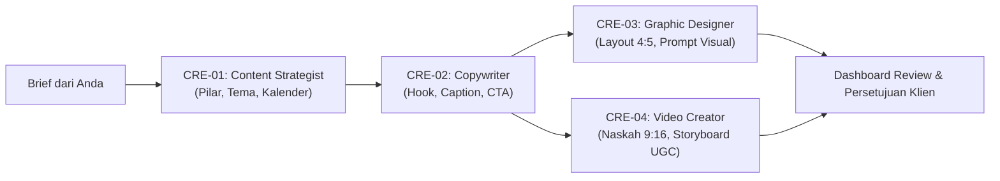

# 📘 BUKU PANDUAN PENGGUNA & TUTORIAL ONBOARDING
## Tim Karyawan AI Content & Creative (`CRE-01` s/d `CRE-04`)
*Solusi Otomasi Konten Kreatif Multi-Channel untuk Segala Industri*

---

## 📑 DAFTAR ISI
1. [Pengantar & Selamat Datang](#1-pengantar--selamat-datang)
2. [Mengenal Tim Karyawan AI Anda](#2-mengenal-tim-karyawan-ai-anda)
3. [Panduan Onboarding 5 Menit (Persiapan Data)](#3-panduan-onboarding-5-menit-persiapan-data)
   - [Template 1: Profil & Brand Guidelines](#template-1-brand-guidelinesmd)
   - [Template 2: Katalog Produk Resmi](#template-2-product-catalogmd)
   - [Template 3: Target Audiens & Persona](#template-3-audience-personamd)
   - [Template 4: Kalender Promo & Event](#template-4-promotional-calendarmd)
4. [Tutorial Langkah Demi Langkah (Step-by-Step)](#4-tutorial-langkah-demi-langkah)
   - [Tutorial 1: Aktivasi Pertama Kali & Unggah Knowledge Base](#tutorial-1-aktivasi-pertama-kali)
   - [Tutorial 2: Memberi Tugas / Brief Pertama ke Tim AI](#tutorial-2-memberi-tugas--brief-pertama)
   - [Tutorial 3: Memantau Alur Kerja Kolaboratif 4 Bot](#tutorial-3-memantau-alur-kerja-kolaboratif)
   - [Tutorial 4: Proses Human Review & Approval (Setujui Konten)](#tutorial-4-proses-human-review--approval)
5. [Contoh Kasus Nyata di 3 Industri Berbeda](#5-contoh-kasus-nyata-di-3-industri-berbeda)
   - [Kasus A: Industri Fashion / Retail](#kasus-a-industri-fashion--retail)
   - [Kasus B: Industri F&B / Coffee Shop](#kasus-b-industri-fb--coffee-shop)
   - [Kasus C: Industri Skincare & Beauty](#kasus-c-industri-skincare--beauty)
6. [Cheatsheet Prompt Siap Pakai (Tinggal Copy-Paste)](#6-cheatsheet-prompt-siap-pakai)
7. [Panduan Anti-Halusinasi & Quality Control](#7-panduan-anti-halusinasi--quality-control)
8. [FAQ (Pertanyaan yang Sering Diajukan)](#8-faq-pertanyaan-yang-sering-diajukan)

---

## 1. Pengantar & Selamat Datang

Selamat datang di ekosistem **Karyawan AI Content & Creative**! 

Dengan sistem ini, Anda telah mengaktifkan **tim kreatif digital berkapasitas penuh** yang bekerja 24/7 tanpa henti. Anda tidak perlu lagi pusing memikirkan jadwal posting, menulis puluhan caption, merancang format visual, atau menyusun naskah video pendek satu per satu.

### Prinsip Utama Sistem Kami:
1. **Plug-and-Play:** Anda tidak memerlukan keahlian koding atau teknis rumit.
2. **Konteks Bisnis Milik Anda:** Bot ini beradaptasi 100% pada nama brand, tone of voice, dan katalog produk Anda.
3. **Kendali Penuh di Tangan Anda (Human-in-the-Loop):** Tim AI menyusun semua rancangan secara otomatis, namun **tidak ada konten yang dipublikasikan sebelum Anda menekan tombol "Setujui"**.

---

## 2. Mengenal Tim Karyawan AI Anda

Tim AI Anda terdiri dari 4 spesialis yang saling terhubung dalam satu jalur produksi (pipeline):



| ID Bot | Nama Peran | Tugas Utama & Hasil Kerja |
| :--- | :--- | :--- |
| **CRE-01** | **Content Strategist** | Merancang pilar konten mingguan/bulanan, menganalisis tren audiens, menyusun kalender editorial, dan menentukan angle promosi yang tepat sasaran. |
| **CRE-02** | **Content & Copywriter** | Menulis 3 variasi hook pembuka yang memikat perhatian dalam 3 detik, caption Instagram/TikTok yang persuasif, hashtag resmi, dan Call-To-Action (CTA). |
| **CRE-03** | **Graphic & Motion Designer** | Merancang struktur visual/kanvas (rasio 4:5), hierarki teks grafis, rekomendasi palet warna brand, dan prompt visual resolusi tinggi untuk bahan poster/carousel. |
| **CRE-04** | **Video & UGC Creator** | Menyusun naskah video vertikal 15–30 detik (rasio 9:16), storyboard per-scene (Hook, Body, CTA), petunjuk gestur talenta UGC, dan rekomendasi audio/sound tren. |

---

## 3. Panduan Onboarding 5 Menit (Persiapan Data)

Agar tim Karyawan AI dapat langsung memahami bisnis Anda tanpa kesalahan informasi (anti-halusinasi), Anda hanya perlu menyiapkan **4 file teks sederhana** atau mengisinya melalui form di dashboard.

Berikut adalah template yang bisa langsung Anda salin (copy-paste) dan sesuaikan isinya:

---

### Template 1: `brand-guidelines.md`
> Simpan file ini untuk menentukan identitas visual dan gaya bicara brand Anda.

```markdown
# PANDUAN IDENTITAS BRAND

## 1. Informasi Dasar
* Nama Brand: [Nama Brand Anda, misal: Kopi Senja Bahagia]
* Industri / Kategori: [misal: F&B / Coffee Shop & Pastry]
* Slogan / Tagline: [misal: "Setiap Tegukan Punya Cerita"]
* Website / Official Store: [misal: www.kopisenjabahagia.com]

## 2. Gaya Bahasa (Tone of Voice)
* Kepribadian Brand: [Pilih: Ramah, Santai, Jenaka, Elegan, Edukatif, Profesional]
* Gaya Sapaan ke Audiens: [misal: Sobat Senja / Bestie / Kakak / Teman Sehat]
* Bahasa: Bahasa Indonesia informal santai (diselingi istilah tren ringan).

## 3. Aturan Larangan (Blacklist & Guardrails)
* DILARANG menyebut atau membandingkan secara negatif nama brand kompetitor.
* DILARANG mengklaim khasiat medis berlebihan tanpa izin BPOM.
* Kata-kata yang dilarang: "termurah se-Indonesia", "pasti kaya", "dijamin sembuh".

## 4. Identitas Visual
* Warna Primer (Hex): #D4A373 (Warm Coffee Cream)
* Warna Sekunder (Hex): #2A1810 (Deep Espresso Brown)
* Warna Aksen (Hex): #CCD5AE (Matcha Green)
* Logo: [Link Google Drive / URL file logo PNG transparan]
```

---

### Template 2: `product-catalog.md`
> **SANGAT PENTING:** Bot mengunci harga dan nama produk dari dokumen ini agar terhindar dari salah harga.

```markdown
# KATALOG PRODUK RESMI

## Produk 1: [Nama Produk Utama, misal: Es Kopi Susu Senja 500ml]
* SKU / Kode: KOP-001
* Kategori: Minuman Dingin (Ready to Drink)
* Harga Resmi: Rp 28.000 (Harga nett di semua gerai)
* Bahan / Komposisi: 100% Kopi Arabika Gayo, Susu Pasteurisasi Segar, Gula Aren Organik.
* Keunggulan Utama (USP): Tidak bikin kembung di lambung, rasa creamy pas tidak kemanisan.
* Link Foto Asli: https://brandanda.com/assets/es-kopi-senja.jpg

## Produk 2: [Nama Produk Kedua, misal: Butter Croissant Crunchy]
* SKU / Kode: PAS-002
* Kategori: Pastry Bakery
* Harga Resmi: Rp 22.000
* Keunggulan Utama: Dibuat segar setiap pagi menggunakan French Butter asli.
* Promo Bundling: Beli Kopi Senja + Croissant hanya Rp 45.000 (Hemat Rp 5.000).
```

---

### Template 3: `audience-persona.md`
> Menentukan kepada siapa konten ditujukan agar tepat sasaran dan engagement tinggi.

```markdown
# TARGET AUDIENS & PERSONA

## Profil Utama
* Usia: 20 – 32 tahun (Gen-Z akhir & Milenial awal).
* Pekerjaan: Karyawan swasta, freelancer, mahasiswa tingkat akhir.
* Lokasi: Kota-kota besar di Indonesia (Jabodetabek, Surabaya, Bandung, dll).

## Masalah & Kebutuhan (Pain Points)
* Sering mengantuk saat jam rawan kerja (pukul 13.00 – 15.00).
* Butuh tempat nyaman untuk kerja laptopan (WFC) dengan WiFi stabil dan colokan melimpah.
* Ingin minum kopi enak setiap hari tapi tetap hemat di kantong.

## Bahasa & Slang yang Disukai
* "Butuh kafein booster", "nongkrong produktif", "comfort food", "anti-wacana".
```

---

### Template 4: `promotional-calendar.md`
> Jadwal promo berkala yang menjadi acuan bot dalam menyusun kalender konten.

```markdown
# KALENDER PROMOSI RESMI

* Promo Mingguan: "Senin Semangat" -> Diskon 15% setiap pembelian jam 08.00 - 11.00.
* Promo Gajian (Payday Sale): Setiap tanggal 25 s/d 30 tiap bulan -> Beli 2 Gratis 1.
* Event Khusus Bulanan: Double Date Sale (misal: 11.11, 12.12) -> Voucher potongan Rp 20.000.
* Hashtag Resmi Brand: #KopiSenjaBahagia #CeritaDiBalikTegukan
* Call-To-Action (CTA) Resmi: "Klik link di bio untuk order via ShopeeFood / GoFood!"
```

---

## 4. Tutorial Langkah Demi Langkah

### Tutorial 1: Aktivasi Pertama Kali
1. Masuk ke halaman **Dashboard Karyawan AI**.
2. Masuk ke menu **Knowledge Base** di sidebar kiri.
3. Unggah ke-4 file template yang telah Anda lengkapi (`brand-guidelines.md`, `product-catalog.md`, `audience-persona.md`, `promotional-calendar.md`).
4. Klik tombol **"Sinkronkan Knowledge"**.
5. Sistem akan menampilkan notifikasi hijau: *"4 Karyawan AI berhasil disinkronkan dengan data brand [Nama Brand Anda]."*

---

### Tutorial 2: Memberi Tugas / Brief Pertama
Anda tidak perlu menyusun prompt yang rumit. Cukup gunakan **Formula 4 Bagian**:
> **Formula Brief:** `[Tujuan Konten]` + `[Produk yang Disorot]` + `[Channel Target]` + `[Pesan Utama / Promo]`

#### Contoh Brief yang Efektif:
> *"Tolong siapkan materi konten untuk Instagram dan TikTok selama 3 hari menyambut Promo Payday weekend ini. Sorot produk Bundling Es Kopi Susu Senja + Croissant dengan diskon Payday Rp 45.000. Targetkan ke pekerja kantoran yang butuh reward akhir bulan."*

---

### Tutorial 3: Memantau Alur Kerja Kolaboratif
Setelah Anda menekan tombol **"Kirim Tugas"**, amati jalannya proses di layar monitoring:
1. **Langkah 1 (CRE-01 Content Strategist):**
   * Menyusun rencana 3 pilar: 1 konten *Hard Selling Promo Payday*, 1 konten *Relatable Entertainment (Meme gajian)*, 1 konten *Edukasi Kualitas French Butter*.
2. **Langkah 2 (CRE-02 Copywriter):**
   * Mengambil rencana CRE-01, lalu memproduksi 3 opsi Hook pemicu rasa penasaran, draf caption lengkap dengan baris spasi rapi, emoji, dan CTA resmi.
3. **Langkah 3 (CRE-03 Graphic Designer):**
   * Menyusun komposisi layout poster Instagram (rasio 4:5), warna latar espresso `#2A1810`, teks promo tajam di tengah, dan instruksi penempatan foto produk asli.
4. **Langkah 4 (CRE-04 Video Creator):**
   * Menghasilkan script video vertikal 20 detik (rasio 9:16) format UGC: *"POV: Gajian udah masuk, langsung self-reward combo kopi + pastry favorit."* lengkap dengan durasi detik per adegan.

---

### Tutorial 4: Proses Human Review & Approval
1. Masuk ke tab **"Draf Menunggu Persetujuan" (Pending Review)**.
2. Anda akan melihat seluruh paket konten: Jadwal, Naskah Teks, Panduan Desain, dan Storyboard Video.
3. Anda memiliki 3 opsi tindakan:
   * **Setujui (Approve):** Konten langsung siap diunduh atau dipublikasikan ke kalender posting.
   * **Revisi Cepat (Quick Tweak):** Ingin sedikit mengubah kata-kata? Ketik di kotak koreksi, misal: *"Ganti kata 'Bestie' jadi 'Sobat Senja' ya."* Bot CRE-02 akan memperbarui naskah dalam hitungan detik.
   * **Tolak (Reject):** Jika tema tidak sesuai kampanye mendadak yang Anda inginkan.

---

## 5. Contoh Kasus Nyata di 3 Industri Berbeda

Berikut gambaran nyata bagaimana tim bot ini beradaptasi otomatis di tiga industri berbeda:

### Kasus A: Industri Fashion / Retail
* **Nama Brand:** *AuraWear Studio*
* **Brief User:** *"Buatkan 1 konten peluncuran koleksi linen shirt musim panas."*
* **Output CRE-01 (Strategi):** Pilar Edukasi Gaya + Peluncuran Baru. Fokus pada bahan breathable adem untuk cuaca panas.
* **Output CRE-02 (Copy):**
  > **Hook 1:** *"3 Kesalahan pakai kemeja di siang bolong yang bikin gerah seharian!"*  
  > **Caption:** *"Stop tahan gerah! Kenalan sama Breeze Linen Shirt dari AuraWear..."*  
  > **CTA:** *"Koleksi terbatas, pesan sekarang sebelum kehabisan size favoritmu via link di bio!"*
* **Output CRE-03 (Desain):** Kanvas 4:5, gaya editorial minimalis, palet earth-tone cream & beige, tipografi sans-serif modern.
* **Output CRE-04 (Video):** Storyboard UGC 15 detik: Transisi dari baju kusut gerah $\rightarrow$ ganti kemeja linen adem dengan senyuman percaya diri.

---

### Kasus B: Industri F&B / Coffee Shop
* **Nama Brand:** *Kopi Senja Bahagia*
* **Brief User:** *"Konten promo jam ngantuk kantor jam 2 siang."*
* **Output CRE-01 (Strategi):** Pilar *Relatable Moment*. Target: Karyawan WFH/WFO yang kehilangan fokus setelah makan siang.
* **Output CRE-02 (Copy):**
  > **Hook 1:** *"Mata 5 watt jam 2 siang? Jangan dipaksa, ini penyelamatnya!"*  
  > **Caption:** *"Fokus buyar tapi tugas belum kelar? Gelas dingin Es Kopi Susu Senja siap recharge energimu..."*  
  > **CTA:** *"Buka GoFood/GrabFood sekarang, klaim diskon ongkir 50%!"*
* **Output CRE-03 (Desain):** Kanvas 4:5, close-up es batu dan tetesan embun gelas kopi segar, teks tebal kontras di tengah atas.
* **Output CRE-04 (Video):** POV kamera mengetik di laptop lambat $\rightarrow$ bunyi notifikasi kurir datang $\rightarrow$ suara *slurp* kopi segar $\rightarrow$ jari mengetik cepat kembali.

---

### Kasus C: Industri Skincare & Beauty
* **Nama Brand:** *DermaGlow Lab*
* **Brief User:** *"Konten edukasi cara layering retinol tanpa iritasi."*
* **Output CRE-01 (Strategi):** Pilar *Expertise & Authority*. Membangun rasa percaya konsumen lewat sains kecantikan yang mudah dipahami.
* **Output CRE-02 (Copy):**
  > **Hook 1:** *"Pernah breakout gara-gara retinol? Mungkin urutan pakai kamu yang keliru!"*  
  > **Caption:** *"Teknik 'Sandwich' adalah sahabat terbaik pemula retinol: Pelembap $\rightarrow$ Retinol $\rightarrow$ Pelembap lagi..."*  
  > **CTA:** *"Simpan postingan ini biar nggak lupa pas skincare-an malam nanti!"*
* **Output CRE-03 (Desain):** Carousel 5 slide infografis bersih (Clean Aesthetic), diagram ilustrasi botol serum dengan penomoran urutan jelas.
* **Output CRE-04 (Video):** Video edukasi mirror shot: Model mendemonstrasikan metode sandwich pada wajah sambil menampilkan tips teks pop-up.

---

## 6. Cheatsheet Prompt Siap Pakai

Tinggal salin dan ganti bagian dalam tanda kurung siku `[...]`:

### 1. Membuat Kalender Konten Mingguan Penuh
```text
Tolong susun kalender editorial lengkap untuk 1 minggu ke depan (Senin sampai Minggu) untuk akun Instagram dan TikTok brand [Nama Brand]. Pastikan komposisi pilar seimbang: 40% Edukasi, 30% Hiburan/Relate, dan 30% Promo Produk [Nama Produk Utama].
```

### 2. Konten Peluncuran Produk Baru (Product Launch)
```text
Kami baru saja meluncurkan produk baru yaitu [Nama Produk Baru] dengan harga promo pengenalan Rp [Harga Promo]. Tolong buatkan paket lengkap: 3 variasi hook memikat dari CRE-02, panduan visual kanvas dari CRE-03, dan storyboard video TikTok 15 detik dari CRE-04.
```

### 3. Konten Flash Sale / Momen Gajian (Urgency)
```text
Buatkan konten promo mendesak untuk event [Payday Sale / Flash Sale 24 Jam]. Berikan penawaran diskon [Diskon % atau Potongan Harga] untuk produk [Nama Produk]. Buatkan caption dengan copywriting FOMO (takut kehabisan) yang sopan dan tidak murahan.
```

### 4. Konten Menjawab Masalah Pelanggan (Pain Point Solution)
```text
Audiens kami sering mengeluhkan masalah [Keluhan Pelanggan, misal: kulit kusam / kopi asam di lambung / baju cepat pudar]. Tolong buatkan konten carousel edukasi yang menjelaskan solusinya dan posisikan produk [Nama Produk] sebagai jawaban terbaiknya.
```

---

## 7. Panduan Anti-Halusinasi & Quality Control

Karyawan AI ini telah diprogram dengan pengaman ketat (**Guardrails**). Namun, pemahaman Anda terhadap sistem ini akan memastikan hasil yang 100% sempurna:

1. **Aturan Harga Terkunci (Zero False Price):**
   * Bot hanya boleh mengutip nominal harga yang tertulis di file `product-catalog.md`.
   * Jika Anda ingin mengadakan diskon di luar katalog, sebutkan secara eksplisit di brief: *"Gunakan harga promo khusus Rp 50.000 (harga normal Rp 75.000)"*.
2. **Foto & Aset Fisik Produk:**
   * Bot CRE-03 dan CRE-04 menyusun **blueprint layout, teks grafis, dan prompt visual**.
   * Tim Anda tinggal memasukkan foto packshot asli produk Anda ke dalam kanvas atau storyboard yang telah dirancang bot.
3. **Pembaruan Katalog (Catalog Update):**
   * Jika ada kenaikan harga atau produk yang habis (out of stock), cukup edit file `product-catalog.md` di dashboard. Bot akan langsung memperbarui memorinya tanpa perlu retraining.

---

## 8. FAQ (Pertanyaan yang Sering Diajukan)

**Q1: Apakah data bisnis dan rahasia katalog saya aman dari kompetitor?**  
*A:* **Sangat aman.** Sistem ini menggunakan arsitektur *Tenant Isolation*. Data katalog dan panduan brand Anda disimpan di partisi terenkripsi yang terpisah secara fisik/database dari pengguna lain. Data Anda tidak pernah digunakan untuk melatih bot klien lain.

**Q2: Bisakah saya meminta bot menggunakan gaya bahasa daerah atau slang khas komunitas saya?**  
*A:* **Tentu bisa.** Anda cukup menambahkan instruksi sapaan dan contoh kosakata di file `brand-guidelines.md` (misal: menggunakan kata *"Rek"*, *"Nde"*, *"Cuy"*, *"Bro-Sis"*). Bot CRE-02 akan otomatis menyelaraskannya.

**Q3: Bagaimana jika saya kurang cocok dengan hasil copy atau desain yang dibuat bot?**  
*A:* Anda tidak perlu mengulang dari awal. Cukup klik tombol **"Minta Revisi"** pada draf tersebut dan tuliskan instruksi spesifik Anda (contoh: *"Tolong buat hook yang lebih santai dan kurangi penggunaan emoji"*). Bot akan merespons dalam beberapa detik.

**Q4: Apakah konten ini bisa langsung otomatis dijadwalkan ke Instagram dan TikTok saya?**  
*A:* Ya, jika Anda menghubungkan akun media sosial Anda melalui integrasi resmi API (Meta Business Suite / TikTok Scheduler) di menu pengaturan integrasi. Namun, konten tetap hanya akan dijadwalkan setelah Anda menyetujuinya di dashboard.

---
*Dokumen ini diterbitkan oleh AI Top Trends sebagai panduan resmi operasional pengguna Karyawan AI Content & Creative.*
