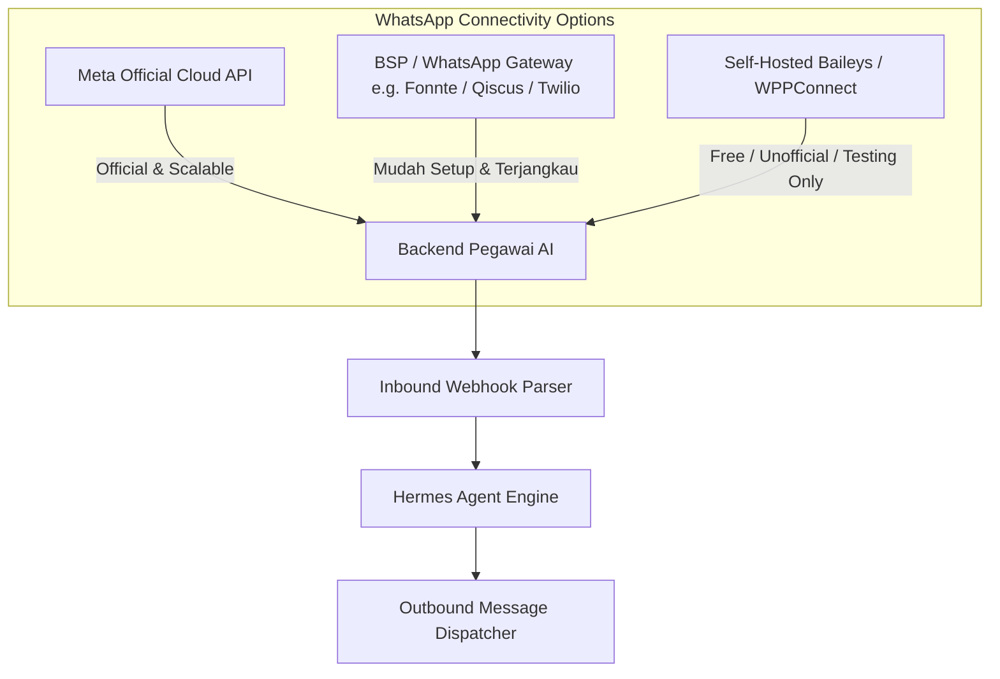
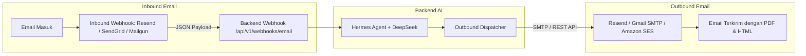

# R&D Report: Arsitektur Backend Otomasi WhatsApp & Email (Pegawai AI)

**Dokumen Riset & Pengembangan (R&D)**  
**Target Proyek:** Pegawai AI (Autonomous Multi-Agent Workflow)  
**Penyusun:** Intern 1 (Backend & Technical Architecture)  
**Tanggal:** 4 November 2026  
**Status:** Architecture Proposal & Feasibility Study  

---

## 1. Executive Summary & Visi Otomasi

Saat ini, sistem **Pegawai AI** telah berhasil membuktikan kemampuan kolaborasi multi-agent (Rian, Diana, Budi di Marketing; Sarah, Hendra di Customer Support; Doni, Maya di Sales) menggunakan backend lokal berbasis **Hermes Agent** dan **DeepSeek V4.1 Flash**.

Namun, penggunaan antarmuka saat ini masih bersifat **Chatbot Pasif (Web-based Turn-based)**:
* Sistem hanya bekerja jika ada manusia yang membuka browser, mengetikkan prompt, dan menunggu hasil selesai.

**Visi Otomasi (*Agentic Automation*)**:
Pegawai AI berevolusi menjadi sistem **Event-Driven & Proactive Assistant** yang terhubung langsung ke kanal operasional bisnis nyata: **WhatsApp** dan **Email**. 
* **Bukan sekadar chatbot tanya-jawab**, melainkan pegawai digital otonom yang bisa:
  1. Menerima trigger dari luar (email masuk, pesan WA dari prospek, webhook formulir, jadwal berkala).
  2. Bekerja di latar belakang (*background task / queue*).
  3. Berkoordinasi antar-agen tanpa campur tangan manusia.
  4. Mengirimkan dokumen penawaran (Email) dan notifikasi instan (WhatsApp).
  5. Meminta persetujuan (*Human-in-the-Loop Approval*) sebelum mengeksekusi aksi berisiko.

---

## 2. Paradigma: Chatbot Tradisional vs. Otomasi Pegawai AI

| Parameter | Chatbot Tradisional (FAQ Bot) | Otomasi Pegawai AI (*Agentic Automation*) |
| :--- | :--- | :--- |
| **Sifat Interaksi** | **Reaktif**: Menunggu user bertanya lebih dulu di jendela chat. | **Proaktif & Event-Driven**: Bekerja saat ada event (misal: lead masuk, jadwal cron, email komplain). |
| **Durasi Respon** | Sinkron (*Synchronous*, harus menjawab dalam <3 detik). | Asinkron (*Asynchronous*): Mengirim pesan awal *"Sedang diproses"*, lalu agen menganalisis 15-30 detik dan mengirim hasil lengkap saat siap. |
| **Eksekusi Tugas** | Hanya menghasilkan teks jawaban. | Memanggil *Tools*: Membuat gambar banner, generate file PDF penawaran, update status CRM, menjadwalkan Google Calendar. |
| **Kanal (Omnichannel)** | Terisolasi di satu widget web atau 1 nomor WA. | **Cross-channel**: Menerima lead via Web Form -> Mengirim proposal via Email -> Follow-up otomatis via WhatsApp. |
| **Validasi Manusia** | Tidak ada (*Full Auto* atau *Human Takeover* total). | **Human-in-the-Loop**: Agen menyusun draf naskah/proposal, lalu mengirim tombol *"ACC"* ke WhatsApp Manager sebelum dipublish. |

---

## 3. Riset Integrasi WhatsApp (Pilihan Arsitektur & Provider)

WhatsApp adalah kanal tercepat untuk komunikasi bisnis di Indonesia. Terdapat **3 jalur arsitektur utama** untuk mengintegrasikan WhatsApp ke backend:



### Opsi A: Official WhatsApp Business Cloud API (Meta Graph API)
* **Cara Kerja**: Backend berkomunikasi langsung dengan server Meta via REST API dan Webhook HTTPS.
* **Kelebihan**:
  * 100% legal dan resmi, **bebas risiko nomor diblokir/banned**.
  * Mendukung tombol interaktif (*Quick Reply Buttons*, *List Messages*, *Flows*).
  * Kapasitas kirim ribuan pesan per menit dengan throughput stabil.
* **Tantangan**:
  * Membutuhkan verifikasi Meta Business Manager & akun Facebook Developer.
  * Ada aturan **24-hour Customer Service Window**: Di luar 24 jam sejak pesan terakhir user, pesan hanya bisa dikirim menggunakan template pesan yang telah disetujui (*Approved Message Template*).
  * Biaya berbasis percakapan (*Conversation-based pricing* oleh Meta).

### Opsi B: WhatsApp Gateway / BSP Lokal (Contoh: Fonnte, Qiscus, WhaCenter, Wablas)
* **Cara Kerja**: Vendor menyediakan API HTTP sederhana (`POST /send-message` dan Webhook `POST /webhook`).
* **Kelebihan**:
  * **Sangat cepat diintegrasikan** untuk tahap PoC dan MVP (cukup butuh API Token).
  * Mendukung nomor biasa tanpa harus verifikasi bisnis Meta yang rumit.
  * Dokumentasi ramah pemula dan integrasi webhook Python hanya butuh beberapa baris kode.
* **Tantangan**:
  * Ada biaya langganan bulanan ke vendor gateway.
  * Masih berpotensi terblokir jika digunakan untuk spam massal agresif.

### Opsi C: Self-Hosted Engine (Baileys / whatsapp-web.js / Node Server)
* **Cara Kerja**: Menjalankan service Node.js lokal yang mengemulasi WhatsApp Web protocol menggunakan Baileys, lalu meneruskan pesan ke backend Python via webhook lokal.
* **Kelebihan**: 100% Gratis, kendali penuh atas sesi dan nomor.
* **Tantangan**:
  * Rentan banned jika nomor baru.
  * Harus scan ulang QR code jika session logout.
  * **Rekomendasi**: Sangat baik untuk riset internal/development testing, tetapi tidak disarankan untuk produksi B2B formal.

---

## 4. Riset Integrasi Email (Inbound & Outbound)

Email adalah kanal formal untuk dokumen, proposal komersial, invoice, dan ringkasan audit.



### A. Pengiriman Email (Outbound)
1. **Modern Email API (Rekomendasi Utama: Resend atau SendGrid)**:
   * Menggunakan HTTP REST API (`pip install resend` atau panggilan `requests.post`).
   * Lebih cepat dan reliabel daripada protokol SMTP lama.
   * Sangat mudah menyematkan file lampiran (*attachments* seperti proposal PDF buatan Maya atau gambar banner dari Budi).
   * Mendukung template HTML modern, tracking open rate, dan bounce handling.
2. **SMTP Relay (Gmail / Google Workspace / Postfix)**:
   * Menggunakan library bawaan Python: `smtplib` dan `email.mime`.
   * Gratis dan tidak butuh provider pihak ketiga jika sudah punya akun Google Workspace perusahaan.
   * Cocok untuk volume pengiriman rendah hingga menengah (<500 email/hari).

### B. Penerimaan Email (Inbound Processing)
Bagaimana Pegawai AI membaca email yang masuk?
1. **Pendekatan Lama: IMAP Polling (`imaplib`)**:
   * Script Python mengecek inbox setiap 1 atau 5 menit.
   * *Kelemahan*: Lambat, membebani server, boros koneksi, berisiko conflict state.
2. **Pendekatan Modern: Inbound Webhook (Rekomendasi)**:
   * Layanan seperti **Cloudflare Email Routing**, **SendGrid Inbound Parse**, atau **Postmark Inbound**.
   * Setiap kali ada email masuk ke `sales@top-trends.ai` atau `cs@top-trends.ai`, layanan langsung mem-parse isi email, pengirim, dan lampiran menjadi format JSON, lalu melakukan HTTP POST ke backend kita:
     `POST http://backend-server/api/v1/webhooks/email`
   * Backend langsung memproses isi email tersebut secara instan (*real-time*).

---

## 5. Arsitektur Backend yang Dibutuhkan untuk Mendukung Otomasi

Saat ini backend `server.py` berbasis `http.server` bawaan Python yang berjalan secara **sinkron dan single-process**. Untuk mendukung otomasi WhatsApp & Email yang handal, dibutuhkan **4 komponen pilar**:

```
[ WhatsApp / Email Inbound ]
            │ (Webhook < 2 detik)
            ▼
┌────────────────────────────────────────┐
│  1. Fast Async Webhook Receiver        │ (FastAPI / Starlette)
│     - Validasi signature webhook       │
│     - Return 200 OK langsung ke Meta   │
└───────────────────┬────────────────────┘
                    │ Push Job
                    ▼
┌────────────────────────────────────────┐
│  2. Message Queue & Task Broker        │ (Redis + Celery / ARQ)
│     - Menampung antrean eksekusi       │
│     - Menjamin pesan tidak hilang      │
└───────────────────┬────────────────────┘
                    │ Consume Job
                    ▼
┌────────────────────────────────────────┐
│  3. Pegawai AI Background Worker       │ (Hermes Agent + DeepSeek)
│     - Menjalankan analisis multi-agent │
│     - Menghasilkan naskah, audit, aksi │
└───────────────────┬────────────────────┘
                    │ Trigger Result
                    ▼
┌────────────────────────────────────────┐
│  4. Outbound Dispatcher & Scheduler    │ (APScheduler / Celery Beat)
│     - Kirim balasan ke WA / Email      │
│     - Penjadwalan follow-up otomatis   │
└────────────────────────────────────────┘
```

### 1. Asynchronous Inbound Handling (FastAPI / Starlette)
* Meta Webhook dan Email Webhook mewajibkan server mengembalikan respon **HTTP 200 OK dalam tempo <3-5 detik**.
* Jika server telat merespons (karena Hermes Agent sedang berpikir selama 20 detik), server Meta/Email akan menganggap server kita down dan akan mengirimkan webhook yang sama berulang-ulang (*infinite retry loop*).
* **Solusi**: FastAPI menerima webhook, menyimpan payload ke antrean dalam tempo 50 milidetik, dan langsung mengembalikan `200 OK`.

### 2. Message Queue & Background Worker (Redis + Celery atau ARQ)
* Proses multi-agent (Rian -> Diana -> Budi atau Doni -> Maya) dijalankan oleh *worker* di latar belakang.
* Jika ada 10 pesan WhatsApp masuk bersamaan, sistem tidak akan crash atau overload karena antrean diatur rapi oleh Redis.

### 3. Persistent Conversation State & Context (SQLite / PostgreSQL)
* Untuk mengetahui riwayat percakapan:
  * Apakah user ini prospek baru atau klien lama?
  * Apakah email ini adalah balasan dari penawaran kemarin?
  * Di tahap mana proses berada? (`STATE_DRAFT_SENT`, `AWAITING_APPROVAL`, `QUALIFIED`).

### 4. Scheduler Engine (APScheduler / Celery Beat)
* Menangani aksi otomatis berbasis waktu:
  * *"Follow-up klien via WA jika dalam 24 jam belum membuka email proposal."*
  * *"Setiap hari Senin jam 08.00 pagi, suruh Rian, Diana, Budi membuat draft konten mingguan dan kirim ringkasannya ke WA Direktur."*

---

## 6. Skenario Nyata Otomasi Pegawai AI (Use Cases)

### Skenario 1: Lead Inbound Nurturing (Divisi Sales: Doni & Maya)
1. **Trigger**: Klien mengisi formulir konsultasi di website / mengirim email ke `halo@top-trends.ai`.
2. **Otomasi Agen**:
   * **Doni** menganalisis data leads (Budget, Otoritas, Kebutuhan, Timeline).
   * **Maya** menyusun draf proposal strategi dan ROI efisiensi.
3. **Eksekusi Otomatis**:
   * Backend mengompilasi draf Maya menjadi email penawaran resmi + PDF proposal yang dikirim langsung ke email klien.
   * Bersamaan dengan itu, backend mengirimkan pesan WhatsApp personal ke nomor klien:
     > *"Halo Pak Ahmad, terima kasih atas ketertarikan Anda pada solusi AI Agency PT AI Top Trends. Tim kami telah menyusun proposal studi kelayakan khusus untuk bisnis Anda dan telah kami kirimkan ke email ahmad@company.com. Silakan ditinjau, dan kami siap berdiskusi jika ada poin yang perlu disesuaikan."*

---

### Skenario 2: Human-in-the-Loop Content Approval via WhatsApp (Divisi Marketing)
1. **Trigger**: Scheduler memicu tugas mingguan setiap Senin pagi.
2. **Otomasi Agen**:
   * **Rian** menulis naskah konten promosi AIDA.
   * **Diana** melakukan QC audit kepatuhan SOP (Skor QC: 94/100).
   * **Budi** membuat konsep visual dan generator membuat banner grafis.
3. **Otomasi WhatsApp (Approval Loop)**:
   * Backend mengirim pesan WhatsApp ke Manajer Pemasaran:
     > *"[DRAF KONTEN SIAP REVIEW]*  
     > *Topik: Edukasi Efisiensi AI untuk UMKM*  
     > *Skor QC Diana: 94/100 (Lolos)*  
     > *[Gambar Banner terlampir]*  
     > *Balas pesan ini dengan ketik:*  
     > *1. 'ACC' untuk langsung jadwalkan posting.*  
     > *2. 'REVISI: [catatan]' jika ada arahan tambahan."*
4. Jika Manajer membalas `"ACC"`, backend langsung memicu proses publikasi tanpa perlu membuka browser.

---

### Skenario 3: Customer Service Escalation & Smart Ticketing (Divisi CS)
1. **Trigger**: Klien mengirim pesan keluhan darurat via WhatsApp di luar jam kerja.
2. **Otomasi Agen**:
   * **Sarah** merespons dengan empati dan memberikan langkah mitigasi awal sesuai SOP CS.
   * **Hendra (QA)** mendeteksi bahwa isu ini berkategori **CRITICAL** (misal: server down atau kendala billing).
3. **Eskalasi Otomatis**:
   * Backend otomatis membuat tiket support di email manajer operasional.
   * Mengirim SMS/WA alert darurat ke WhatsApp tim teknis on-call untuk penanganan instan.

---

## 7. Matriks Analisis Biaya, Kompleksitas & Legalitas

| Komponen | Opsi yang Tersedia | Estimasi Biaya | Tingkat Kesulitan | Kelaikan untuk Tahap Berikutnya |
| :--- | :--- | :--- | :--- | :--- |
| **WhatsApp Inbound/Outbound** | **Fonnte / Gateway Lokal** | Sangat Terjangkau (~Rp 50rb - 100rb/bulan) | **Rendah (Mudah)** | ⭐⭐⭐⭐⭐ **Sangat Direkomendasikan untuk Tahap Awal / MVP**. |
| **WhatsApp Official** | **Meta Cloud API** | Berbasis percakapan (~$0.03 - $0.05 / percakapan) | **Tinggi (Perlu verifikasi Meta)** | ⭐⭐⭐ Direkomendasikan setelah bisnis resmi beroperasi skala besar. |
| **Email Outbound** | **Resend / SendGrid** | Gratis tier 3.000 email/bulan | **Rendah (Mudah)** | ⭐⭐⭐⭐⭐ **Sangat Direkomendasikan**. API modern, cepat, & andal. |
| **Email Inbound** | **Cloudflare Email Routing / Mailgun Webhook** | Gratis | **Sedang (Perlu konfigurasi domain DNS)** | ⭐⭐⭐⭐ Sangat ideal untuk menghubungkan email perusahaan ke webhook. |
| **Backend Framework** | **Migrasi ke FastAPI + Background Tasks** | Gratis (Open Source) | **Sedang** | ⭐⭐⭐⭐⭐ Standar industri untuk agentic automation. |

---

## 8. Rekomendasi Tahapan Implementasi (Roadmap)

### Fase 1: Prototype Otomasi (Proof of Concept - Sprint 3)
* **Email Outbound**: Integrasikan library pengiriman email (Resend / SMTP) ke dalam backend `server.py`. Saat agen Maya membuat proposal, salinannya otomatis bisa dikirim ke email tujuan.
* **WhatsApp Outbound**: Gunakan WhatsApp Gateway sederhana untuk membuktikan fitur notifikasi otomatis ke nomor manajer/user setelah agen selesai mengerjakan tugas.
* **Non-blocking Dispatch**: Memisahkan trigger webhook dengan proses Hermes Agent agar tidak terjadi *request timeout*.

### Fase 2: Full Two-Way Interaction (Sprint 4)
* Mengimplementasikan **Inbound Webhook**: User bisa membalas langsung dari WhatsApp/Email dan balasan tersebut diteruskan kembali ke Hermes Agent untuk percakapan multi-turn.
* Menambahkan **State Machine** di database lokal (SQLite) untuk mencatat status alur kerja (*Workflow Engine*).

### Fase 3: Production Grade Omnichannel (Fase Rilis)
* Migrasi ke **Meta WhatsApp Business Cloud API Resmi**.
* Dashboard terpadu untuk monitoring metrik pengiriman email, open rate, dan log interaksi agen dengan pelanggan.

---
*Dokumen R&D ini dapat digunakan sebagai dasar perancangan teknis arsitektur backend lanjutan pada sprint mendatang.*

